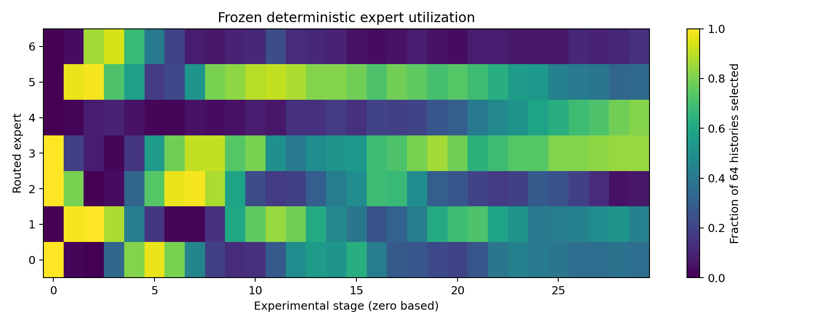
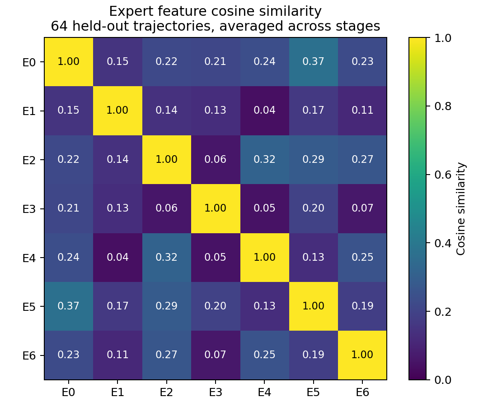
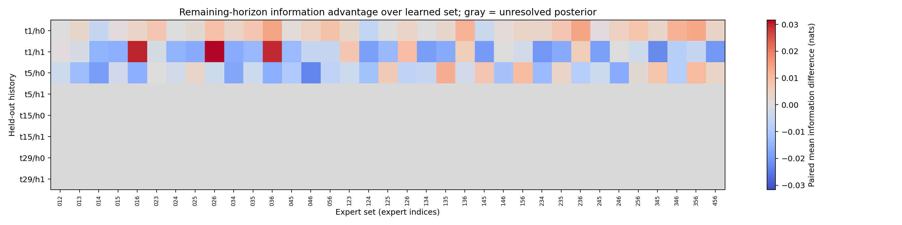
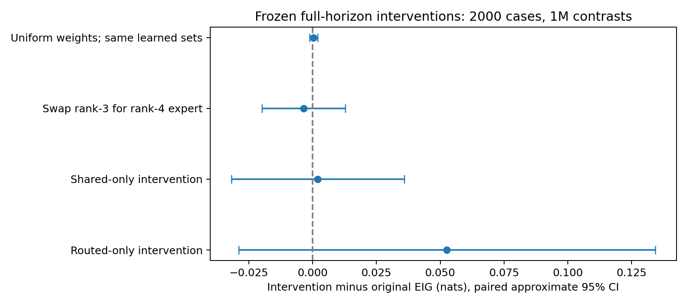
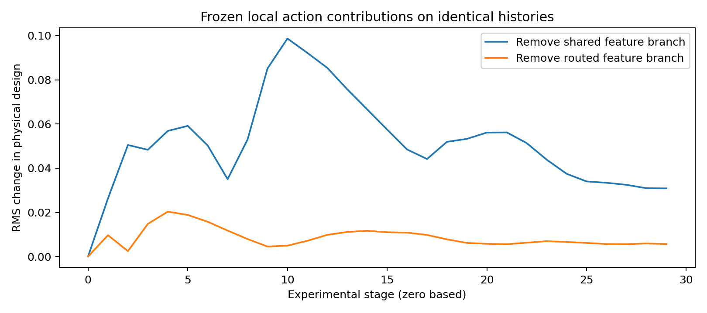

# IR-MoE-sBOED final expert-specialization report

**Conclusion: D. Insufficient reliable evidence.**

The experts produce different feature vectors and measurably different designs. The saved diagnostics do not establish useful context-dependent information specialization or a learned-routing advantage. Only three of eight conditional histories have adequate importance-posterior references; middle and late estimates are withheld. This is not proof that specialization is impossible.

## Frozen model and completed run

The model has one always-active shared width8 SwiGLU expert, seven routed width8 experts, top-three routed activation, a shared 3-256-ReLU-16 sum encoder, and one shared design head. Experts emit hidden features, not independent experiment-design policies. There are 8,434 parameters, with 6,898 activated per context. The latent output is mapped to the original [-4,4] box.

Training seed101 completed 14232 updates in 14390.523 charged seconds and stopped at the compute cap. The selected checkpoint is update14232. The latest logged sPCE is 8.749205 at update14200; no unlogged value at the final update is invented. Training used 8,192 contrasts and 30 stages.

Checkpoint SHA256: f16860948e467bec75fa3ae07938937786322347e802caa31c24c65b0bc05a91.

The legacy controller says FAILED_PRESERVED because the report writer attempted Path-plus-string concatenation AFTER training, both IR evaluations, and comparisons had completed. The checkpoint is numerically finite, all frozen source/config hashes were verified, and saved per-trajectory scores reproduce the official summary. This report repairs artifact reporting in a separate worktree; it does not rewrite the original registry or results.

## Official EIG and verified paired comparisons

Official seed1001 EIG: **10.81546708 +/- 0.04607956 nats** (trajectory MC SE conditional on the shared bank),2000 trajectories,1000000 contrasts,T30.

| Reference | Reference mean | IR minus reference | Paired MC SE | Approximate95% CI | N |
|---|---:|---:|---:|---|---:|
| DeepSeekMoE-v1 | 10.98906590 | -0.17359881 | 0.05403101 | [-0.27949959, -0.06769804] | 2000 |
| vsOED | 12.48084689 | -1.66537980 | 0.05684466 | [-1.77679533, -1.55396428] | 2000 |
| Corrected DAD | 10.27611286 | 0.53935422 | 0.06107940 | [0.41963860, 0.65906985] | 2000 |

Truth samples, standard-normal observation noise, trajectory order and contrast-bank bytes were reverified for vsOED and corrected DAD. The DeepSeekMoE-v1 record has the same saved draw identity. Paired SEs come from paired trajectory-score differences, not method-level means/SEs. The legacy DAD result is excluded. The one training seed is not multi-seed evidence.

Previously reserved confirmation seed1079 gave 10.90325091 +/- 0.04336984 nats. Neither official nor confirmation results were used to retune or replace the checkpoint.

## Answers to the eight questions

1. **Different feature functions?** Yes on the audited inputs: mean off-diagonal expert cosine is 0.182517, range [0.042138, 0.367458]. The frozen functions are not identical. Without an initialization comparison this does not establish that diversity emerged through learning, and it does not establish information competence.

2. **Different designs?** Yes. Across all 35 sets, within-history design dispersion RMS ranges from 0.001620 to 0.004371 on the eight audited prefixes. Removing the routed feature sum changes physical designs by mean RMS 0.008579, versus 0.051521 for removing the shared branch. These local interventions use identical histories.

3. **Different information values?** Point estimates differ, but no alternative has a reliably positive advantage over the learned set under the saved familywise screening rule. The reliable-reference rows have best observed gains only0.01396 +/-0.01814,0.03169 +/-0.02810, and0.01252 +/-0.02707 nats (paired MC SE). Noisy maxima are not reliable wins.

4. **Different combinations advantageous in different histories?** Not established. Different point-estimate maximizers occur, but their uncertainty overlaps zero. Only three references are usable; all middle/late references and one early reference fail the ESS screen.

5. **Learned routing beats uniform routing?** Not established. With the SAME selected sets and routed feature mass, learned-minus-uniform-weight EIG is -0.00041942 +/- 0.00084380 nats; approximate 95% CI [-0.00207327, 0.00123444]. The learned weights do not show an advantage.

6. **Routing improves full-horizon EIG?** Not demonstrated by the frozen interventions. Controlled swaps and masking changes all have paired intervals containing zero. This does not identify the effect of retraining an entirely different architecture.

7. **All seven routed experts necessary?** Not established. Removing the entire routed branch gives10.81752224 nats versus10.81546708 for the full policy: +0.00205515 +/-0.01728294. The approximate 95% interval [-0.03181941,0.03592971] shows no detected loss. This does not prove a minimal expert count: seven individually retrained removal controls are absent, and no equivalence margin was predeclared.

8. **Limits relative to vsOED?** The observed routing interventions do not explain the1.66538-nat gap. Confirmed findings are small routed action influence, no detected information benefit from the tested routing changes, and unresolved later-history posterior references. Near-ceiling finite-contrast training and gradient variance are plausible contributors, not established causes. Optimization convergence and the value of a different architecture remain unresolved.

## Conditional competence: early, middle and late

For each fixed observed history, two independent262144-particle standard-normal prior banks are weighted by the full observed-prefix likelihood. No generating hidden theta is appended or treated as the posterior. Each reference supplies32 posterior-predictive fantasies and65536 conditional contrasts per fantasy. All35 expert sets are evaluated at the CURRENT decision; the SAME frozen original deterministic policy controls every remaining decision, with paired future noise/parameters. The reported Q is remaining-horizon conditional sPCE, not immediate gain. Immediate values were saved separately.

This is a finite-importance-posterior approximation. MC SEs are conditional on those empirical posterior banks; they do not quantify all posterior approximation error. Two-bank sensitivity is recorded, and ESS>=128 is required in both banks. ESS alone is not a convergence certificate. A familywise normal threshold z=3.74027 covers the predeclared8x34 alternative-versus-selected comparisons, with matching positive direction across posterior replicates.

Two independently simulated trajectories each supply four prefixes. The eight histories are not eight independent training runs or eight independent physical systems. Stage t is the number of completed experiments; the next experiment is t+1.

| Group | Prefix stage | History | Posterior ESS, two banks | Decision |
|---|---:|---:|---|---|
| Early | 1 | 0 | 159689.23, 159684.21 | Retained |
| Early | 1 | 1 | 2340.39, 2404.56 | Retained |
| Early | 5 | 0 | 10911.88, 10913.85 | Retained |
| Early | 5 | 1 | 24.32, 20.53 | EXCLUDED: posterior degeneracy |
| Middle | 15 | 0 | 18.09, 12.52 | EXCLUDED: posterior degeneracy |
| Middle | 15 | 1 | 13.87, 6.37 | EXCLUDED: posterior degeneracy |
| Late | 29 | 0 | 5.93, 2.90 | EXCLUDED: posterior degeneracy |
| Late | 29 | 1 | 1.79, 3.08 | EXCLUDED: posterior degeneracy |

| Retained prefix/history | Learned set | Point-best alternative | Advantage over learned | Paired MC SE | Familywise reliable win? |
|---|---|---|---:|---:|---|
| t1/h0 | [1, 2, 5] | [2, 3, 6] | 0.01396036 | 0.01813759 | No |
| t1/h1 | [1, 4, 6] | [0, 2, 6] | 0.03169254 | 0.02810303 | No |
| t5/h0 | [0, 2, 3] | [1, 3, 5] | 0.01251713 | 0.02706878 | No |

Gray cells in the competence matrix mean excluded/unresolved posterior references, not zero information advantage. Different point-best sets are not assigned invented exploration/localization roles.

## Frozen full-horizon routing and ablation results

All rows below use the exact same 2,000 canonical cases, noise and1M-contrast bank. These are frozen-model interventions, not retrained methods. The identity/context feature residual remains present in shared-only and routed-only interventions.

| Policy/intervention | EIG mean | MC SE | Intervention minus original | Paired MC SE | Approximate95% CI |
|---|---:|---:|---:|---:|---|
| Original learned routing | 10.81546708 | 0.04607956 | 0 | 0 | reference |
| uniform_selected_weights | 10.81588650 | 0.04610069 | 0.00041942 | 0.00084380 | [-0.00123444, 0.00207327] |
| controlled_swap | 10.81193538 | 0.04553194 | -0.00353170 | 0.00831836 | [-0.01983570, 0.01277229] |
| shared_only | 10.81752224 | 0.04579851 | 0.00205515 | 0.01728294 | [-0.03181941, 0.03592971] |
| routed_only | 10.86809549 | 0.04499724 | 0.05262840 | 0.04164775 | [-0.02900118, 0.13425799] |

A DIFFERENT uniform control samples random expert subsets and equalizes weights while preserving learned top3 mass. On the saved256-case/L262144 development bank, learned-minus-that-control is 0.00363754 +/- 0.02193456, also inconclusive. It must not be conflated with uniform weights on fixed learned membership.

The original learned PL stochastic deployment diagnostic gave -0.00615417 +/- 0.02328250 nats relative to deterministic routing on the same development bank, averaged over three routing seeds. That provides no demonstrated stochastic-versus-deterministic advantage. It did not change deployment selection. Three-seed averaging does not fully quantify routing-seed or bank uncertainty.

The available dense control exceeds IR on the256-case development bank: IR-minus-dense -0.28722683 +/- 0.12698042. It reused a lower-contrast training control, so this is not a clean architecture-only causal comparison.

## Bottlenecks: findings versus hypotheses

- **Confirmed:** all seven routed experts had gradient tensors at all 14,232 optimizer updates. Logged nonzero expert gradients argue against gross training starvation; tensor presence is not proof of competence.
- **Confirmed:** the shared feature norm averages 0.186664, versus 0.029860 for the routed sum. Shared-induced design changes are about 6.01 times larger. This is feature/action dominance, not a demonstrated information advantage of the shared branch.
- **Confirmed:** mean router entropy is 1.944691, close to log7=1.945910. Yet hard selections vary by stage and within stage; high entropy does not mean the router ignores history, and usage differences do not prove information specialization.
- **Empirical limit:** latest logged training sPCE 8.749205 is 0.261831 below the finite-L ceiling log8193=9.011035. Near-ceiling training can reduce information resolution; it does not establish that true EIG is optimal.
- **Empirical limit:** 100.0% of logged updates exceed the norm5 clipping threshold. Logged gradient median=69.2126, maximum=3075.7571. Temporal score-gradient variability includes parameter drift; it is not a fixed-policy variance estimate. Gradient noise as the cause of poor routing is plausible, not proven.
- **Unresolved:** feature redundancy in information acquisition versus a router failing to exploit complementary competence. The present Q intervals and excluded histories cannot discriminate these explanations.
- **Unresolved:** optimization convergence. The same development bank improves from10.30536 at5000 updates to10.61710 at10000; no same-bank final14232 development estimate was saved. Different final-bank scores are not a continuation of that curve.

The next justified modification is to improve and validate later-history posterior references and reduce variance in conditional remaining-information differences before assigning expert roles or changing expert count. Then test information-grounded credit assignment in a separately declared study. No new training, architecture change, checkpoint selection, or official reevaluation is performed by this report.

## Cost, integrity and limitations

Successful bounded GPU diagnostics took 169.663 seconds of exclusive-device wall allocation (budget600s); exact kernel busy time was not profiled. The four saved full-protocol interventions each use2000 trajectories/L1M/T30, and three stochastic deployment repetitions use256/L262144. Conditional competence cost and exact parameter-stage propagation counts are in costs.json. The first failed diagnostic attempt completed64 feature trajectories (1920 parameter-stage propagations) before a CPU/CUDA bank-placement error; its elapsed GPU wall time was not recorded and is not assumed zero. Its log and failure record remain preserved.

Original training cost was 14390.523 charged seconds, 28464000 primary trajectories and 13992333120000 executed parameter-stage propagations including replay/recomputation. New report generation performs no simulator calls. The saved online latency is 0.631848 ms mean (0.632165 ms median), single-case synchronized neural inference; no online optimizer or simulator is involved.

One training seed, one consumed historical official bank, small held-out conditional-history coverage, finite posterior/contrast approximations and no individually retrained expert-removal controls limit conclusions. Original checkpoints, optimizer state, configurations and result files remain unchanged.

## Figures and saved evidence

CSV tables and JSON uncertainty/provenance records are in ir_moe_labpc_diagnostics/. Raw source diagnostic outputs remain in /home/grads/g/g.lin/Documents/objective_power_grid_ir_analysis/experiments/10242026/10242026_ir_moe_labpc_diagnostics.
