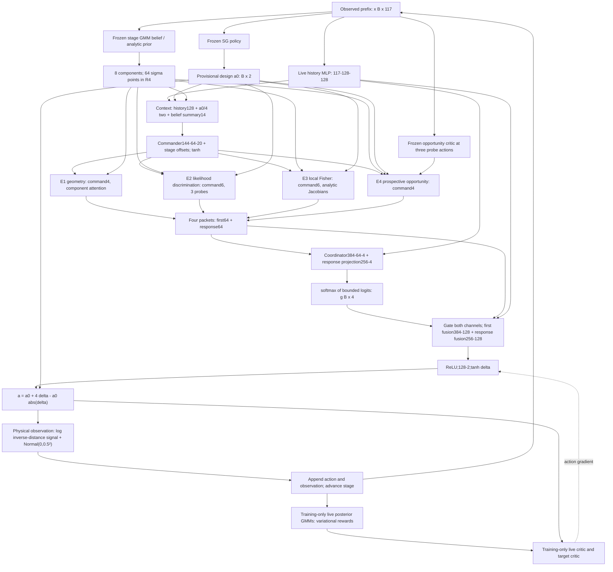

# HEC-v2 PI technical briefing

Prepared 2026-11-12 for a 30-minute meeting. Scope: the actual frozen **V2Actor candidate at native iteration 16001**, not HEC-v1, HEC-v2.1, CER, or RR-MoE. This is a technical research report, not promotion to an official benchmark result.

**Meeting message:** HEC-v2 is a dense, command-conditioned, model-assisted feature collaboration policy around a frozen SG reference action. It is not a sparse Top2 policy and its four experts do not independently output designs. Collaboration is useful under the saved frozen interventions; the extra value of learned history-dependent coordination and four distinct conditional competencies is not established.

Evidence labels: **Verified** means directly inspected source/checkpoint or CPU forward execution in this audit. **Measured (saved)** means historical receipt, evaluation, or training log. **Hypothesis** means an interpretation or untested scientific claim. All forward checks here used saved prefixes, CPU, no optimizer steps and no new observation simulation. No historical model or source was edited. The original frozen actor/runtime/source hashes were checked before and after inspection.

## 1. Concrete B=2 forward trace first

Use zero-based decision index t=0,15,29 (physical decisions 1,16,30). All policy floating tensors below are **torch.float32**; argmax stage and gather indices are **torch.int64**, masks bool. The fixed-width history remains [2,117] throughout. It consists of stage one-hot [2,30], padded previous designs [2,29,2] flattened to [2,58], and padded previous scalar observations [2,29] (not interleaved). Unknown future entries are zero. These are ordered raw history features, not a sum encoder.

| Quantity | Beginning t=0 | Middle t=15 | End t=29 |
|---|---|---|---|
| Available observed pairs | 0 | 15 | 29 |
| Packed history x | [2,117] | [2,117] | [2,117] |
| Approximate-belief input | analytic N(0,I4), no posterior net | [2,45] -> frozen net index 14 | [2,87] -> frozen net index 28 |
| GMM w; mu,sd | [2,8]; [2,8,4] each, w=(1,0,...), mu=0,sd=1 | same shapes, learned values | same shapes, learned values |
| Deterministic nodes; node weights | [2,64,4]; [2,64] | same | same |
| SG provisional a0; live history s | [2,2]; [2,128] | same | same |
| Commander context; commands | [2,144]; [2,20] | same | same |
| E1 token MLP -> attention pooling | [2,8,9] -> [2,8,64] -> [2,64] | same | same |
| E2 token MLP -> attention pooling | [2,64,4] -> [2,64,64] -> [2,64] | same | same |
| E3 Fisher; MLP | [2,4,4]; [2,14] -> [2,64] | same | same |
| E4 critic probes; legacy MLP | [2,3,119] -> [2,3,1]; [2,14] -> [2,64] | same | same |
| E2/E4 analytic responses | [2,12] each | same | same; E4 future opportunity 9 coordinates exactly zero |
| E2/E4 adapters | [2,36] -> [2,52]; [2,20] -> [2,52] | same | same |
| Four first channels; four response channels | [2,4,64] each | same | same |
| Four full expert packets | [2,4,128] | same | same |
| Coordinator context; response context | [2,384]; [2,256] | same | same |
| Logits and gates | [2,4] each | same | same |
| First fusion input; response fusion input | [2,384]; [2,256] | same | same |
| Added preactivation; ReLU | [2,128] | same | same |
| Residual delta; final physical design | [2,2] each | same | same |

E4's legacy remaining feature is (30-t)/30: 1, 0.5, 1/30; the prospective response multiplier is (29-t)/29: 1,14/29,0. Terminal evaluation still takes the 30th observation; no 31st design is made. Posterior net index 29 consumes all 30 observed pairs [2,90] for terminal reward, but is not queried to choose a design in a T30 episode.

**Executed CPU trace on the first two saved diagnostic trajectories:**

- t=0: action=[[0.6421645283699036, 0.5230408906936646], [0.6421645283699036, 0.5230408906936646]]; maximum absolute error against saved GPU action = 0.

- t=15: action=[[0.20303991436958313, 1.7569471597671509], [0.8708718419075012, 1.3716621398925781]]; maximum absolute error against saved GPU action = 2.38e-07.

- t=29: action=[[-0.06635123491287231, 0.029259782284498215], [-0.7235084176063538, 0.37057653069496155]]; maximum absolute error against saved GPU action = 2.98e-07.

All three paths were executed with hooks on actual checkpoint modules; shape details are in VERIFIED_INSPECTION.json. CPU/GPU differences up to 3e-7 here are numerical, not evidence of retraining. No new rollout was generated.

## 2. Actual architecture and data flow

Verified observation model: theta [B,4] is two 2D source locations with standard-normal prior; a [B,2] lies in [-4,4]^2. m(theta,a)=log(0.1 + sum_{j=1}^2 1/(||theta_j-a||²+1e-4)); y=m+0.5 epsilon. The policy receives observed data and an approximate belief, not the true theta. Native training can use simulator theta to fit variational posteriors and calculate rewards; this is separate from policy input.

Frozen providers inside the actor are distinct from the **live native training posterior and critic**. The frozen SG policy is itself a larger previously trained network with its own four homogeneous feature experts and anchors; it is not an identity shortcut. Thus there are more networks than the four newly named heterogeneous pathways.

## 3. Networks, dimensions, activations and exact parameter inventory

Counts below were read from the actual runtime and matched actor state tensors to actor.pt exactly. “Layers” counts affine layers, not activation modules. All listed live weights are float32. Phase C trainability is the historical terminal flag; **during this briefing no weights were optimized**. Frozen neural weights were converted to registered buffers, so PyTorch reports zero Parameters for them; that does not mean zero stored weights or zero computation.

| Module | Affine layout and activations | Affine layers | Parameter elements | Phase C requires_grad elements |
|---|---|---:|---:|---:|
| history | 117→128 ReLU→128 ReLU | 2 | 31,616 | 31,616 |
| commander | 144→64 Tanh→20; final command Tanh | 2 | 10,580 | 10,580 |
| region | 9→64 SiLU→64; weighted pooling over 8 | 2 | 4,800 | 4,800 |
| discriminate | 4→32 SiLU→64; weighted pooling over 64 | 2 | 2,272 | 2,272 |
| sensitivity | 14→96 SiLU→64 | 2 | 7,648 | 7,648 |
| sequential | 14→64 SiLU→32 SiLU→64 | 3 | 5,152 | 5,152 |
| coordinator | 384→64 Tanh→4 | 2 | 24,900 | 24,900 |
| ordinary | 128→4 (unused alternative) | 1 | 516 | 516 |
| fusion | 384→128 ReLU→2; delta Tanh | 2 | 49,538 | 49,538 |
| adapter2 | 36→96 SiLU→52 | 2 | 8,596 | 8,596 |
| adapter4 | 20→96 SiLU→52 | 2 | 7,060 | 7,060 |
| response_gate | 256→4, no bias | 1 | 1,024 | 1,024 |
| response_fusion | 256→128, no bias | 1 | 32,768 | 32,768 |
| readouts | four diagnostic heads64→14/9/9/3 | 4 | 2,275 | 0 |
| response_readouts | diagnostic heads52→3 and52→6 | 2 | 477 | 0 |

There is also a learned stage_logits [30,20] parameter = 600 elements; reference_logits [30,20] is a buffer, not another trainable table. Actor **189,822 Parameter elements**, of which **187,070 require gradients** in terminal phase C. Frozen readouts account for 2,752; the 516-element ordinary alternative is marked trainable but unused in candidate forward. Thus the phase-C policy-function active live count is **186,554**. Phase B additionally freezes the 31,616-element history (active count 154,938). No sparse execution is implied by these counts. Calibration tables and frozen provider/anchor weights add **15,266,041 buffer elements**; total actor stored elements = **15,455,863**. Buffers include non-weight constants/calibration state; do not call every buffer a learned parameter.

| Frozen provider / training network | Architecture | Weight/count and trainability |
|---|---|---|
| E1 anchor1 / E3 anchor3 | copies of region9→64→64 / sensitivity14→96→64, SiLU | 4,800 / 7,648 buffer weights; zero trainable |
| Actor opportunity critic |119→256 ReLU→256 ReLU→256 ReLU→1 |162,561 frozen buffer weights; 4 affine layers |
| Live native critic / target critic |same119→256→256→256→1 |162,561 each; live critic trained, target Polyak updated |
| Frozen GMM belief |30 stage nets; feature MLP3n→256 ReLU→256 ReLU; three branches256→256 ReLU→256 ReLU→8/32/32 |14,736,240 frozen neural weights; 392 constants (bounds/scales/points); no trainable |
| Live posterior bank |same 30 GMM nets, one per n=1,…,30 observed pairs |14,736,240 live parameters total; trained separately; no normalizing flows |
| Frozen SG base |encoder117→128 ReLU→128 ReLU; four live and four anchor experts128→128 ReLU→64 ReLU; router128→4; retention128→4; decision256→128 ReLU→2; delta256→128 no bias |330,280 stored buffer elements, zero trainable in HEC-v2; includes task readouts64→16/8/5/1 (1,950 elements) |

For each posterior with n pairs, exact neural parameter count is **479,304+768n**: feature trunk 66,816+768n, mixture-weight branch133,640, mean and sigma branches139,808 each. Each has 11 affine layers in the full branched graph; a path from input to one branch output traverses 5 affine layers. Softmax mixture weights [B,8], sigmoid-transformed means/scales [B,8,4]; log density input additionally theta [B,4], output [B]. Means use learned-network outputs mapped through stored mu_bounds; sd uses stored max_sigmas and +1e-5. The normalized forward mixes density with 1e-27 prior mass and divides by 1+1e-27. The belief uses 8 fixed ±2 basis offsets per component, yielding64 deterministic nodes (not64 independent samples).

Frozen SG output is [B,2] after sigmoid map to [-4,4]. It encodes x twice (live/anchor), computes all eight homogeneous experts and combines first and retained delta features. Main subnetwork counts: encoder31,616 each; expert24,768 each; router516; retention516; decision33,154; delta32,768; task readouts1,950. The exact leaf-module inventory, including all 30 posterior sizes, is recorded in VERIFIED_INSPECTION.json and the appendix.

## 4. Commands, router equations and model-derived features

Let w_j,mu_j,sd_j be8-component diagonal GMM parameters. Define m=sum w mu, scale=sqrt(clamp(sum w(mu²+sd²)-m²,1e-5)), and normalized component centers. Context u=[s,a0/4,m,log(1+variance),six normalized off-diagonal component-mean covariance entries] has144 values (context variance floor1e-6). Commands are

`c=tanh(commander(u) + stage_logits[t] - reference_logits[t])`, split **4/6/6/4**. Candidate uses current history context; stage-only control uses calibrated per-stage context. These20 commands alter actual computations:

- **E1 geometry:** alpha_j=softmax(log w_j + ((mu_j-m)/scale)·c1/2). Region MLP sees9 values [mu/3,log sd,w] per component, pooled with alpha. First channel is frozen anchor output a1; response is z1-a1. Commands change belief-region attention.
- **E2 discrimination:** direction=normalize(c2[0:2]+[1,0]); three actions clip(a0 + {0,+1,-1}direction). Predict exact m(theta,a) for64 nodes. Hypothesis attention=softmax(log p_node + ((theta-m)/scale)·c2[2:6]/2). The4-value legacy token is three predictions/5 plus attention; pooled legacy z2 is64. An additional command-tilted plus/minus belief pair uses v=normalize(c2[2:6]+[1,-1,1,-1]); weights proportional p_node exp(± standardized-node·v). For each probe, response has log1p((Vplus+Vminus+(Mplus-Mminus)²)/0.5), normalized mean separation, log1p(4Vplus), log1p(4Vminus): **12 analytic coordinates**. Adapter input36=[semantic12,hplus/3 four,hminus/3 four,a0/4 two,c2 six,m/3 four,log scale four]; adapter outputs52. First=z2; response=[semantic12,adapter52].
- **E3 local sensitivity:** queried action=clip(a0+c3[4:6]); J=analytic derivative of log signal w.r.t. four theta coordinates at each node. F=4 sum p_node J Jᵀ, shape[B,4,4], using noise variance0.25. v=normalize(c3[0:4]+[1,-1,1,-1]). Input14=[signed log1p of ten upper-triangle F entries,v4]. First=a3 frozen anchor; response=z3-a3. Commands change both query location and tested parameter direction. Fisher is a local approximation, not exact EIG.
- **E4 prospective opportunity:** direction=normalize(c4[0:2]+[0,1]); radius=1+0.5c4[2] in[0.5,1.5]; three actions clip(a0+{0,+1,-1}radius direction). Frozen critic receives[x,probe]119, giving3 values; qdiff=(q-q_center)/10. Legacy14=[qdiff3,signal means/5 three,log1p signal variances3,(30-t)/30,c4 four]. Prospective response uses systematic8-node approximation of current64-node belief; at3 first probes and3 predictive observation quadrature points (offsets±sqrt3,0 with weights1/6,2/3,1/6), likelihood-reweights the8 nodes, derives2D source-center posterior means, and probes3 future actions in command-rotated direction angle=pi*c4[3]/2. Nine future log1p(4*predictive variance) features are quadrature averaged and multiplied by(29-t)/29;3 immediate categorical KL-like features complete12. Adapter input20=[semantic12,qdiff3,remaining1,c4 four]→52. First=z4; response=[semantic12,adapter52]. This is an approximate model-based opportunity representation, not exact conditional mutual information. Searchsorted node selection is discrete; gradients do not pass through its integer selection indices.

All four packets are computed. Let first_k,response_k each have64 values. Coordinator context is `[s,z1,z2,z3,z4]`384 using **legacy** live features, not the512-value packet concatenation. Response context concatenates four response channels (256).

`raw = coordinator([s,legacy.flatten]) + response_gate(response.flatten)`

`g = softmax(10*tanh(raw/10))` (four deterministic positive weights summing to1).

`h = fusion[0]([s,flatten(g_k*first_k)]) + response_fusion(flatten(g_k*response_k))`

`delta=tanh(fusion[2](ReLU(h)))`; `a=a0+4*delta-a0*abs(delta)` elementwise.

The action transform preserves bounds[-4,4] because delta is in[-1,1] and a0 is in[-4,4]. A gate changes feature amplitudes, not probabilities of executing experts. Uniform forces all g=.25; expert-only forces one-hot g in **both** channels but retains commands/history/a0/shared head. Command overrides act upstream on queries, so they are distinct from coordination overrides. “features” in returned diagnostics is first+response[B,4,64]; the true packet is `slots`[B,4,128].

## 5. Specialization targets, training data and evidence

**Verified provenance:** fresh Collaborative→SG→HEC-v1→HEC-v2; the heterogeneous HEC experts were newly initialized at the HEC-v1 transition, not copied from Collaborative's homogeneous experts. HEC-v1's300-step specialist preparation used4,096 replay prefixes plus512 validation, uniformly sampled stages, half zero/half random commands, Adam0.001, batch256. Targets used frozen approximate-belief quantities and predictive simulation, not replay latent theta:

| Pathway | HEC-v1 preparation target | HEC-v2 additional target |
|---|---|---|
| E1 geometry |14: mixture CDF evaluated at tilted mean4, log1p variances4, correlations6 |same diagnostic target; no new E1 supervised preparation |
| E2 discrimination |9:3 predictive means/5,3 log1p variances/noise,3 normalized third moments |3 rotated-probe log1p pair-separation scores; direction rotated45 degrees from commanded direction |
| E3 Fisher |9:log1p eigenvalues4, squared weakest eigenvector4, log1p directional Fisher1 |same diagnostic target; no new E3 supervised preparation |
| E4 opportunity |3 one-step predictive variational-gain plus frozen-continuation-value contrasts/10 (2 replicas) |6: second-observation variational gain contrasts/5 and tail-critic contrasts/10 (4 replicas); follow frozen HEC-v1 policy after first query |

V2 preparation sampled4,608 distinct replay indices from inherited1M capacity; random t=0..29; first4,096 train,last512 validation. Commands alternate in four patterns: live, calibrated stage, zero, uniform[-.9,.9]. Teacher uses four conditional-belief latent/noise replicas with shared future noise across query alternatives, not ground-truth hidden replay labels. It physically generated108,876 synthetic predictive observations and zero fresh real episodes. It trains **only adapters2/4 and their52→3/6 response readouts**,300 Adam steps at0.001,batch256; loss=sum standardized target MSE with train-set std floor0.1. Held-out E2 MSE2.63555→0.28784; E4 0.82090→0.39908. All old HEC-v1 tensors are asserted unchanged, and initial policy actions match the reference within1e-6. During native V2 training all auxiliary losses are zero; diagnostic heads frozen.

**Measured differentiation:** held-out ridge probes use116 learned coordinates per expert (first64 plus response tail52), deliberately excluding12 analytic bypass coordinates;256 calibration/256 validation histories at t=3,12,24. Designated advantage is the held-out loss of the strongest rival expert (selected by calibration loss) minus designated-expert loss, averaged across the three stages within each validation history. E2:+0.05163,95%CI[0.02902,0.07424],Holm4 p=3.15e-5; E3:+0.29585,[0.25577,0.33592],p=1.09e-34. E1:−0.00880,CI crosses0; E4:−0.00237,CI crosses0. Therefore **two designated probe advantages, not proof of four uniquely specialized experts**. Probe task fit and different features do not establish useful history-dependent selection or conditional complementary EIG. Frozen one-hot interventions support internal collaboration, but also change activation scale/distribution.

## 6. Initialization, freezing, native training and gradients

Frozen target checkpoint: `moe_hec_v2_icml_20261109/arms/candidate/actor.pt`, SHA256 **90797b277846dd1a5d7de3764f6fb021047530d1fbea7db859f938ef59b73108**. Matching runtime SHA256 **d38c09167c4936a6a0660d16079ecc3d5e1108c32bdbc840cc8851c1ef7266b1**, native counter16001. Immediate HEC-v1 parent actor SHA **f8eb269c3a63668b5e7cad45dc4d91377505ce38d8896d9c420cb8f9439e8b09**, runtime **19f2905763323a8b45529006cc4e011d491f6768d78453ecb699e81247b5cd0a**, counter14001. These identify this briefing's object unambiguously.

- Inherited: HEC-v1 history, commander, four heterogeneous expert MLPs, coordinator, fusion, diagnostic readouts; preserved compatible actor Adam objects/moments; live native critic/posteriors, target networks, replay and schedules. SG base, actor belief and opportunity critic remain frozen snapshots inherited from HEC-v1 construction (SG stage), not continually replaced by newly trained native providers.
- New V2 anchors: frozen copies of parent E1/E3. New adapters2/4 and response readouts use PyTorch seeded initialization with seed202611099202; prepared as above. response_gate initialized zero; response_fusion initialized zero except E1/E3 blocks copied from parent fusion first-channel blocks. This preserves parent action because first+response reconstructs the parent E1/E3 output; E2/E4 response blocks initially contribute zero.
- stage_context30×144, stage_coord_context30×384, stage_response_context30×256 calibrated from preparation prefixes; reference_logits=commander(stage_context); stage_logits initialized equal reference_logits, so stage offset initially zero. Candidate and stage start with identical actor tensor digests; stage-only execution changes the context lookup.
- Exact earlier lineage: SG actor at12001 SHA256 `8e4082bb7c6710ce99f229cbbf0d0b39113f124549875038fce93796e6f7a95e`, SG runtime `56f2b8f721340f1659c365032e29f53e34dad66e0f4a39bffb2b37588cda1406`. HEC-v1 fresh-module construction seed202611099101, teacher seed202611099102, preparation prefix seed202611099103. SG inherited Collaborative actor at10001 SHA256 `837bcca20af6521e2db0a589d48695efd9b6620407ffc85729a891a5d81986b3`, runtime `77db8045f1d1c5beae009c465ecdaee5ab74ff1ebcc41e4ff3c6018eb1642981`; original Collaborative actor seed202611088001 and expert seeds202611088101–202611088104. These are source-config provenance, not a claim that heterogeneous HEC experts share those old expert weights.
- At original HEC-v1 creation, history copied from SG then actual live SG encoder and its Adam restored by migration; new specialist MLPs/commander/fusion were fresh. Commander last layer, coordinator last layer, ordinary head and final fusion layer started zero. Their final checkpoint is **not** zero-initialized or untrained; it includes HEC-v1 and V2 optimization.

| Phase | Native counter / updates | Optimized modules and data |
|---|---|---|
| Ancestral Collaborative |0→10001 |fresh actor/native providers;10,001 updates plus20k initial replay; continuous old task losses |
| SG |10001→12001 |2,000 continuation updates; anchor/delta policy, native variational AC |
| HEC-v1 prep then B/C |12001→14001 |300 supervised steps; B200 freezes history AND experts, C1800 joint |
| V2 shared preparation |no native counter advance |300 supervised steps; adapters2/4+response readouts only |
| V2 B |14001→14201,200 |**only history frozen**; all four experts, commander, fusion, adapters and gates learn; readouts frozen |
| V2 C |14201→16001,1800 |history also learns; frozen providers/anchors stay buffers |

The V2-specific `migrate_v2.phase` overrides the older HECActor phase rule: do not mistakenly say V2 experts are frozen in B. Candidate/stage each receive2M new real episodes /60M observations. Three arms (continuation,stage,candidate) ran sequentially:6M episodes/180M observations across the V2 campaign, plus shared teacher work. Candidate lineage through V2 is16,021,000 primary episodes /480,630,000 observations, excluding all teacher/preflight/evaluation calls and controls. The counter does not mean each new parameter got16,001 updates.

**Native losses and optimization:** no PCE contrast bank is used for training. Live posterior stage n minimizes negative log q_n(theta|observed prefix) on simulator replay. Incremental reward r_t=log q_{t+1}(theta|h_{t+1})−log q_t(theta|h_t), with prior at t0, discount1. Actor loss is `−mean Q_live(x,actor(x))` over10,000 replay trajectories×30 decisions=300,000 rows. Critic MSE retains native transition-mixed Monte Carlo/TD logic; the frozen profile has transition=0, so factor=1 and the actual target is r_t+gamma Q_target(next history,actor_target(next history)); final-stage target sums final reward slots. Actual native code retains this transition logic, rather than simply fitting exact EIG.

Per native actor iteration:1,000 new episodes; draw10,000 trajectories from1M replay;5 updates of each30 posterior nets=150 posterior optimizer steps;5 critic steps;1 actor step; target weights Polyak tau0.1; actor/critic ExponentialLR0.9999 and exploration decay0.9999. V2 candidate totals actor2,000,critic10,000,posterior300,000 steps. Actor's checkpointed4096-row chunks do not reduce minibatch. Native posterior optimization is separate from actor parameters; actor belief computation and SG action use no_grad. Frozen critic weights do not update, but differentiating its output with respect to commanded probe inputs allows command gradients. Likewise exact signal and analytic Fisher features permit gradients through continuous commands. Discrete prospective node indices have no selection gradient.

Native posterior Adam groups each contain the weights of one stage network; the frozen training profile initializes posterior LR0.001. No actor, posterior and critic weights are shared between optimizer groups. Actor Adam: one group189,822 allocated parameter elements (including unused/frozen heads); critic Adam one group162,561; betas(.9,.999),eps1e-8,weight_decay0. Initial V2 actor LR0.00024655504363736653, terminal0.00020186017780594474; exploration0.12327752181868122→0.10093008890297059. Old compatible moments retained; new V2 parameter moments begin fresh, preparation Adam is saved separately, not silently transplanted into native Adam. Every native posterior has its own optimizer; full tensor/layer bank documented below. Actor backward traverses live critic action derivatives; only actor optimizer is stepped there (critic parameter gradients may be allocated then cleared by its own subsequent zero_grad). This is deterministic policy gradient through a learned critic, not backpropagation through new observations over a whole differentiable simulator episode.

## 7. Saved EIG and intervention results

Finite-prior-contrast estimator: for each complete trajectory, score=positive cumulative log likelihood −logsumexp(positive plus1M prior-negative cumulative log likelihoods)+log(1,000,001). Scorer accumulates in float64; policy is float32. Reported MCSEs/CIs condition on the saved bank and one trained lineage. These are lower-bound estimates, not exact EIG or training-seed uncertainty.

### Same original V2 bank / internal-ablation bank

2,000 trajectories,T30,1M negatives, evaluation batch16,contrast chunk16,384. Original candidate score vector reproduced **exactly** by internal audit (maximum score error0). Internal interventions resimulate complete changed-policy trajectories with common theta/noise; do not reuse original observations after changing designs.

| Policy | EIG nats | MCSE | Full minus policy,95% paired CI |
| full | 12.929353 | 0.035016 | — |
| expert1 | 11.193217 | 0.050998 | +1.73614 [+1.63857,+1.83370] |
| expert2 | 11.942015 | 0.047489 | +0.98734 [+0.89908,+1.07559] |
| expert3 | 11.421067 | 0.049217 | +1.50829 [+1.41284,+1.60373] |
| expert4 | 12.427823 | 0.041914 | +0.50153 [+0.42638,+0.57668] |
| uniform | 12.937944 | 0.033807 | -0.00859 [-0.06229,+0.04511] |
| conventional_moe | 12.120527 | 0.044393 | +0.80883 [+0.71219,+0.90546] |

All four full-minus-single-pathway differences survive Holm5. Full−uniform=−0.00859,95%CI[−0.06229,+0.04511],Holm5 p=.7537: **no demonstrated learned-coordination advantage**, not proof of equivalence. Expert4 is best observed one-hot intervention, not a separately trained expert policy or proven population winner. Conventional MoE comparison is secondary and not compute/capacity/initialization matched.

Original predeclared V2 primary contrasts: candidate−stage **+0.00582**,95%CI[−0.04504,+0.05668],Holm2 p=.8225; candidate−HEC-v1 matched continuation **+0.08263**,[+0.03179,+0.13347],p=.002916. Candidate−frozen v1 **+0.05159**,[−0.00606,+0.10923],Holm4 p=.0794. The package improves on continuation in this lineage, but evidence does not isolate history-dependent commander superiority. Initial-adjusted training gain against stage is also inconclusive:+0.02779,[−0.03289,+0.08847].

On the256-case command diagnostic panel, full−zero commands +0.31673,[+0.10689,+0.52656],Holm3 p=.00971; full−stage commands−0.08484,[−0.19536,+0.02567],p=.2636; full−shuffled commands+0.04577,[−0.06166,+0.15321],p=.4022. Zero-command damage supports command sensitivity, not useful within-stage history dependence.

### Independent later RR evaluation bank (separate; never pair across banks)

Same frozen HEC-v2 checkpoint scored **12.947994 ±0.035326 MCSE**; uniform HEC **12.926559 ±0.034994**. RR learned Top2 **12.942145 ±0.035031**, RR uniform-training control12.913560 ±0.035766. RR−HEC-v2−0.00585,95%CI[−0.05437,+0.04267],Holm3 p1.0. Different banks explain differing reported HEC means; they are not new checkpoint variants or contradictory measurements. Do not substitute RR adaptation removal for original HEC single-pathway ablations.

## 8. Measured CPU/GPU cost and scientific challenges

All HEC-v2 campaign GPU work used RTX4090. Candidate native training receipt: **4,663.505s (77m44s)**,2,000 updates,**2.33175s/update**,peak torch allocation**2,691,335,680 bytes (2.507GiB)**. Matched continuation3,488.469s; stage/candidate all-arm costs are in SAVED_RECEIPTS/COMPUTE_COMPARISON historical report. Shared V2 preparation6.840s. Whole three-arm driver13,613.987s (**3h46m54s**); this is not candidate-only time. CPU-seconds for V2 training were not separately saved in the candidate RESULT, so do not infer exact historical CPU or GPU utilization/energy from wall time.

Candidate primitive counters: frozen-belief rows1,218,000,000; frozen-SG rows1,240,000,000; exact signal evaluations1,148,160,000,000; analytic parameter Jacobians117,760,000,000; frozen opportunity-critic rows5,520,000,000. These count model-query/recomputation work including checkpointed actor gradients; **not independently simulated observation counts**. Live native critic/posterior work is additional. Frozen deterministic querying has substantial deployment cost despite few live parameters.

Internal-ablation full evaluation measured41.818 wall seconds,41.838 process CPU seconds,peak GPU allocation189,232,640bytes,process max RSS1,528,086,528bytes;60,000 observed simulations,60B negative and60k positive observation-density terms. Saved one-case inference measurement **3.0534ms/design**. Warmup/repeats and workload differ from batch scoring; this is not a throughput guarantee or pure GPU kernel time. Process max RSS is cumulative high-water,torch peak excludes reservation/context; wall seconds are not GPU busy seconds or energy. Older runtime efficiency audit covers **HEC-v1**, so its1h58m/2.5655ms claims must not be relabeled as V2 costs.

Main challenges to discuss:

1. **Coordination attribution:** no reliable gain over frozen uniform or trained stage control; varying gates/commands is insufficient evidence of intelligent history-dependent allocation.
2. **Specialization attribution:** E2/E3 probe advantage only; E1/E4 intended semantics are not all empirically confirmed. Analytic bypass features must be separated from learned competence.
3. **Fair cost accounting:** warm starts, frozen providers, target/critic/posterior training, teacher calls and inheritance must be charged explicitly. Sparse routing is not implemented here.
4. **Statistical resolution:** one training lineage, reused development bank, finite-contrast bias, noisy conditional panels and multiple testing; no held-out final-test or multi-seed generalization established.
5. **Causal ablations:** one-hot interventions change feature amplitudes/distribution; a shared-head one-expert result is not standalone expert quality. Need matched training controls to attribute causal architecture benefits.

These are scientific interpretation limits, not proposals to launch additional computation in this task.

## 9. Thirty-minute PI presentation outline

| Minutes | Topic | Concrete material |
|---|---|---|
|0–3|Question and evidence status|one-line claim; exact checkpoint; distinguish collaboration from routing |
|3–8|Actual forward pass|diagram and B=2 t0/15/29 trace; packets vs designs |
|8–13|Four expert mechanisms|commands4/6/6/4, analytic responses and learned adapters |
|13–18|Initialization and optimization|warm-start lineage; frozen providers vs live native networks; B/C distinction |
|18–24|Results and uncertainty|same-bank one-hot/uniform table; primary stage/continuation contrasts; probe evidence |
|24–27|Costs and limits|77m44 candidate vs3h47 campaign; dense querying; uncertainty and fairness |
|27–30|PI decisions|five questions below; prioritize scientific claim before new experiments |

Five questions:

1. Should the defensible central claim be **collaborative heterogeneous feature fusion**, given the inconclusive learned-vs-uniform and candidate-vs-stage results?
2. What outcome would convince us that history-dependent commands/coordination are useful beyond a trained stage schedule and a capacity-matched residual control?
3. Do we require all four intended expert competencies to be demonstrated, or can the architecture be simplified around the E2/E3 evidence?
4. Which resource budget should govern the next comparison: new real episodes, full inherited training cost, wall time, or deployment latency—and which providers must be charged?
5. What predeclared multi-seed and held-out evaluation standard is needed before a publication-level advantage claim, and what negative result would make us stop this direction?

## 10. Evidence map and preservation

All source artifacts below are on LabPC beneath `/home/grads/g/g.lin/Documents/objective_power_grid_temp/scratch_runs/`:

- `moe_hec_v2_icml_20261109/source/{v2_policy.py,hec_policy.py,query_response.py}`: executed architecture and command equations.
- `source/{migrate_v2.py,prepare_v2.py,v2_tasks.py,train_v2.py,normalized_reward.py,restore_v1.py}` in that root: phases, loss/data, optimizer lineage and provider semantics.
- Same root `CONFIG_LOCKED.json`, `PRETRAIN_MANIFEST.json`, `SOURCE_PROVENANCE.json`, `arms/candidate/{actor.pt,runtime.pkl,STARTED.json,RESULT.json}`, `preparation/RESULT.json`, `TRAINING_LOGS/candidate_metrics.jsonl` and `evaluation/{EIG_RESULTS.json,COMMANDER_RESULTS.json,COMPETENCY_RESULTS.json,CONDITIONAL_COMPETENCE.json,diagnostic_candidate_histories.npz}`.
- `moe_hec_v2_internal_ablation/{ARCHITECTURE_AUDIT.md,RESULTS.json,PAIRED_COMPARISONS.md,full_receipt.json,source/audit.py}`: exact same-checkpoint one-hot and uniform definitions and measured resource receipts.
- `moe_rr_sboed_20261111/RESULTS.json`: separate later common-bank reference evaluation.
- `moe_hec_runtime_efficiency_audit_20261109/RUNTIME_AND_EIG_EFFICIENCY_ANALYSIS.md`: ancestral Collaborative/SG/HEC-v1 accounting only.
- Actual imported vendor implementation: `moe_development_migration_20261105/imported_ubuntu_tree/scratch_runs/20261104T161647Z_direct_head_moe_vsoed_seed101/source/src/research/vendor/vsoed/{pg_vsoed.py,post_approx.py}`. Native training exact loss code inspected, not inferred from generic algorithm labels.

Adjacent `VERIFIED_INSPECTION.json` contains checkpoint/runtime equality, every leaf module and parameter count, CPU hook trace, saved-action comparisons and source/model SHA preservation results. Adjacent `SAVED_RECEIPTS.json` is a compact read-only extraction of historical receipts, not model weights/datasets. Scratch-only raw audit material remains in `scratch_runs/hec_v2_pi_technical_brief_20261112/`; only this report and safe technical summaries are versioned. No large checkpoints, replay datasets, score arrays or credentials are placed in Git. The synchronization receipt is external to the commit to avoid a self-referential commit hash.

## Appendix: exact live posterior bank counts and leaf inventories

Posterior n is after n observations, with x_post=[past designs2n,past scalar observations n], float32. Each accepts theta[B,4] and returns float32 log q[B].

| n | Input width | Neural parameters | Trainable in native training |
|---:|---:|---:|---:|
|1|3|480,072|480,072|
|2|6|480,840|480,840|
|3|9|481,608|481,608|
|4|12|482,376|482,376|
|5|15|483,144|483,144|
|6|18|483,912|483,912|
|7|21|484,680|484,680|
|8|24|485,448|485,448|
|9|27|486,216|486,216|
|10|30|486,984|486,984|
|11|33|487,752|487,752|
|12|36|488,520|488,520|
|13|39|489,288|489,288|
|14|42|490,056|490,056|
|15|45|490,824|490,824|
|16|48|491,592|491,592|
|17|51|492,360|492,360|
|18|54|493,128|493,128|
|19|57|493,896|493,896|
|20|60|494,664|494,664|
|21|63|495,432|495,432|
|22|66|496,200|496,200|
|23|69|496,968|496,968|
|24|72|497,736|497,736|
|25|75|498,504|498,504|
|26|78|499,272|499,272|
|27|81|500,040|500,040|
|28|84|500,808|500,808|
|29|87|501,576|501,576|
|30|90|502,344|502,344|

Exact actor leaf inventory (P=Parameter elements,T=terminal trainable elements,F=buffer elements; zero-weight activations shown). This lists nested frozen SG and GMM providers as well as live experts. Repeated posterior architectures are already specified by n above.

### `base`

| Leaf | Definition | P | T | F |
|---|---|---:|---:|---:|
|encoder.0|Linear(in_features=117, out_features=128, bias=True)|0|0|15104|
|encoder.1|ReLU()|0|0|0|
|encoder.2|Linear(in_features=128, out_features=128, bias=True)|0|0|16512|
|encoder.3|ReLU()|0|0|0|
|experts.0.0|Linear(in_features=128, out_features=128, bias=True)|0|0|16512|
|experts.0.1|ReLU()|0|0|0|
|experts.0.2|Linear(in_features=128, out_features=64, bias=True)|0|0|8256|
|experts.0.3|ReLU()|0|0|0|
|experts.1.0|Linear(in_features=128, out_features=128, bias=True)|0|0|16512|
|experts.1.1|ReLU()|0|0|0|
|experts.1.2|Linear(in_features=128, out_features=64, bias=True)|0|0|8256|
|experts.1.3|ReLU()|0|0|0|
|experts.2.0|Linear(in_features=128, out_features=128, bias=True)|0|0|16512|
|experts.2.1|ReLU()|0|0|0|
|experts.2.2|Linear(in_features=128, out_features=64, bias=True)|0|0|8256|
|experts.2.3|ReLU()|0|0|0|
|experts.3.0|Linear(in_features=128, out_features=128, bias=True)|0|0|16512|
|experts.3.1|ReLU()|0|0|0|
|experts.3.2|Linear(in_features=128, out_features=64, bias=True)|0|0|8256|
|experts.3.3|ReLU()|0|0|0|
|router|Linear(in_features=128, out_features=4, bias=True)|0|0|516|
|task_heads.0|Linear(in_features=64, out_features=16, bias=True)|0|0|1040|
|task_heads.1|Linear(in_features=64, out_features=8, bias=True)|0|0|520|
|task_heads.2|Linear(in_features=64, out_features=5, bias=True)|0|0|325|
|task_heads.3|Linear(in_features=64, out_features=1, bias=True)|0|0|65|
|anchor_encoder.0|Linear(in_features=117, out_features=128, bias=True)|0|0|15104|
|anchor_encoder.1|ReLU()|0|0|0|
|anchor_encoder.2|Linear(in_features=128, out_features=128, bias=True)|0|0|16512|
|anchor_encoder.3|ReLU()|0|0|0|
|anchor_experts.0.0|Linear(in_features=128, out_features=128, bias=True)|0|0|16512|
|anchor_experts.0.1|ReLU()|0|0|0|
|anchor_experts.0.2|Linear(in_features=128, out_features=64, bias=True)|0|0|8256|
|anchor_experts.0.3|ReLU()|0|0|0|
|anchor_experts.1.0|Linear(in_features=128, out_features=128, bias=True)|0|0|16512|
|anchor_experts.1.1|ReLU()|0|0|0|
|anchor_experts.1.2|Linear(in_features=128, out_features=64, bias=True)|0|0|8256|
|anchor_experts.1.3|ReLU()|0|0|0|
|anchor_experts.2.0|Linear(in_features=128, out_features=128, bias=True)|0|0|16512|
|anchor_experts.2.1|ReLU()|0|0|0|
|anchor_experts.2.2|Linear(in_features=128, out_features=64, bias=True)|0|0|8256|
|anchor_experts.2.3|ReLU()|0|0|0|
|anchor_experts.3.0|Linear(in_features=128, out_features=128, bias=True)|0|0|16512|
|anchor_experts.3.1|ReLU()|0|0|0|
|anchor_experts.3.2|Linear(in_features=128, out_features=64, bias=True)|0|0|8256|
|anchor_experts.3.3|ReLU()|0|0|0|
|decision.0|Linear(in_features=256, out_features=128, bias=True)|0|0|32896|
|decision.1|ReLU()|0|0|0|
|decision.2|Linear(in_features=128, out_features=2, bias=True)|0|0|258|
|retention|Linear(in_features=128, out_features=4, bias=True)|0|0|516|
|delta_head|Linear(in_features=256, out_features=128, bias=False)|0|0|32768|

### `opportunity`

| Leaf | Definition | P | T | F |
|---|---|---:|---:|---:|
|net.0|Linear(in_features=119, out_features=256, bias=True)|0|0|30720|
|net.1|ReLU()|0|0|0|
|net.2|Linear(in_features=256, out_features=256, bias=True)|0|0|65792|
|net.3|ReLU()|0|0|0|
|net.4|Linear(in_features=256, out_features=256, bias=True)|0|0|65792|
|net.5|ReLU()|0|0|0|
|net.6|Linear(in_features=256, out_features=1, bias=True)|0|0|257|

### `history`

| Leaf | Definition | P | T | F |
|---|---|---:|---:|---:|
|0|Linear(in_features=117, out_features=128, bias=True)|15104|15104|0|
|1|ReLU()|0|0|0|
|2|Linear(in_features=128, out_features=128, bias=True)|16512|16512|0|
|3|ReLU()|0|0|0|

### `commander`

| Leaf | Definition | P | T | F |
|---|---|---:|---:|---:|
|0|Linear(in_features=144, out_features=64, bias=True)|9280|9280|0|
|1|Tanh()|0|0|0|
|2|Linear(in_features=64, out_features=20, bias=True)|1300|1300|0|

### `region`

| Leaf | Definition | P | T | F |
|---|---|---:|---:|---:|
|0|Linear(in_features=9, out_features=64, bias=True)|640|640|0|
|1|SiLU()|0|0|0|
|2|Linear(in_features=64, out_features=64, bias=True)|4160|4160|0|

### `discriminate`

| Leaf | Definition | P | T | F |
|---|---|---:|---:|---:|
|0|Linear(in_features=4, out_features=32, bias=True)|160|160|0|
|1|SiLU()|0|0|0|
|2|Linear(in_features=32, out_features=64, bias=True)|2112|2112|0|

### `sensitivity`

| Leaf | Definition | P | T | F |
|---|---|---:|---:|---:|
|0|Linear(in_features=14, out_features=96, bias=True)|1440|1440|0|
|1|SiLU()|0|0|0|
|2|Linear(in_features=96, out_features=64, bias=True)|6208|6208|0|

### `sequential`

| Leaf | Definition | P | T | F |
|---|---|---:|---:|---:|
|0|Linear(in_features=14, out_features=64, bias=True)|960|960|0|
|1|SiLU()|0|0|0|
|2|Linear(in_features=64, out_features=32, bias=True)|2080|2080|0|
|3|SiLU()|0|0|0|
|4|Linear(in_features=32, out_features=64, bias=True)|2112|2112|0|

### `readouts`

| Leaf | Definition | P | T | F |
|---|---|---:|---:|---:|
|0|Linear(in_features=64, out_features=14, bias=True)|910|0|0|
|1|Linear(in_features=64, out_features=9, bias=True)|585|0|0|
|2|Linear(in_features=64, out_features=9, bias=True)|585|0|0|
|3|Linear(in_features=64, out_features=3, bias=True)|195|0|0|

### `coordinator`

| Leaf | Definition | P | T | F |
|---|---|---:|---:|---:|
|0|Linear(in_features=384, out_features=64, bias=True)|24640|24640|0|
|1|Tanh()|0|0|0|
|2|Linear(in_features=64, out_features=4, bias=True)|260|260|0|

### `ordinary`

| Leaf | Definition | P | T | F |
|---|---|---:|---:|---:|
|(root)|Linear(in_features=128, out_features=4, bias=True)|516|516|0|

### `fusion`

| Leaf | Definition | P | T | F |
|---|---|---:|---:|---:|
|0|Linear(in_features=384, out_features=128, bias=True)|49280|49280|0|
|1|ReLU()|0|0|0|
|2|Linear(in_features=128, out_features=2, bias=True)|258|258|0|

### `anchor1`

| Leaf | Definition | P | T | F |
|---|---|---:|---:|---:|
|0|Linear(in_features=9, out_features=64, bias=True)|0|0|640|
|1|SiLU()|0|0|0|
|2|Linear(in_features=64, out_features=64, bias=True)|0|0|4160|

### `anchor3`

| Leaf | Definition | P | T | F |
|---|---|---:|---:|---:|
|0|Linear(in_features=14, out_features=96, bias=True)|0|0|1440|
|1|SiLU()|0|0|0|
|2|Linear(in_features=96, out_features=64, bias=True)|0|0|6208|

### `adapter2`

| Leaf | Definition | P | T | F |
|---|---|---:|---:|---:|
|0|Linear(in_features=36, out_features=96, bias=True)|3552|3552|0|
|1|SiLU()|0|0|0|
|2|Linear(in_features=96, out_features=52, bias=True)|5044|5044|0|

### `adapter4`

| Leaf | Definition | P | T | F |
|---|---|---:|---:|---:|
|0|Linear(in_features=20, out_features=96, bias=True)|2016|2016|0|
|1|SiLU()|0|0|0|
|2|Linear(in_features=96, out_features=52, bias=True)|5044|5044|0|

### `response_readouts`

| Leaf | Definition | P | T | F |
|---|---|---:|---:|---:|
|0|Linear(in_features=52, out_features=3, bias=True)|159|0|0|
|1|Linear(in_features=52, out_features=6, bias=True)|318|0|0|

### `response_gate`

| Leaf | Definition | P | T | F |
|---|---|---:|---:|---:|
|(root)|Linear(in_features=256, out_features=4, bias=False)|1024|1024|0|

### `response_fusion`

| Leaf | Definition | P | T | F |
|---|---|---:|---:|---:|
|(root)|Linear(in_features=256, out_features=128, bias=False)|32768|32768|0|
