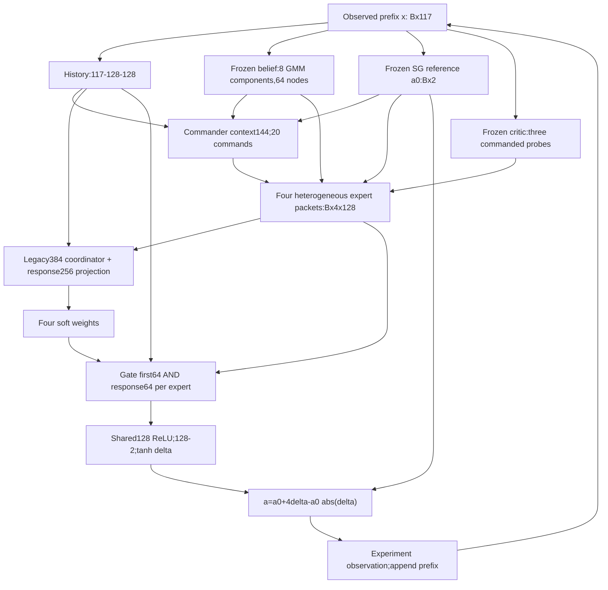

# Architecture and tensor shapes

Audit date: 2026-11-12. Exact object: frozen V2Actor candidate, native iteration16001, actor SHA256 `90797b277846dd1a5d7de3764f6fb021047530d1fbea7db859f938ef59b73108`. This is not V2.1, RR-MoE, or the later routing pilot.

Source aliases on LabPC: `B=/home/grads/g/g.lin/Documents/objective_power_grid_temp/scratch_runs/moe_hec_v2_icml_20261109`; `A=/home/grads/g/g.lin/Documents/objective_power_grid_temp/scratch_runs/moe_hec_v2_internal_ablation`; `V=/home/grads/g/g.lin/Documents/objective_power_grid_temp/scratch_runs/moe_development_migration_20261105/imported_ubuntu_tree/scratch_runs/20261104T161647Z_direct_head_moe_vsoed_seed101/source/src/research/vendor/vsoed`. Locations below use these exact aliases and line numbers. Measured CPU evidence: `/home/grads/g/g.lin/Documents/objective_power_grid_temp/scratch_runs/moe_hec_v2_code_audit/verification_02/MEASURED_AUDIT.json`. Five deterministic unit tests plus actual-checkpoint tests; 114 protected files hash-preserved, zero optimizer steps, zero new observation simulations, zero GPU jobs. No native objective or historical model/source was changed.

## Actual computation

Every expert executes. This is dense soft-gated feature collaboration, not Top1/Top2 execution. The commander changes actual queries; the coordinator changes consumed feature weights. The expert packets are not four complete experimental designs.

## Exact shapes and dtypes

`B` below is batch size, distinct from source alias B. All floating policy tensors/weights are torch.float32. Integer stage, searchsorted and gather indices are torch.int64; masks are bool. Existing evaluation banks/scorer accumulations are float64. Float64 is used only for the audit's numerical derivative check, not to modify model precision.

| Quantity | Shape / transformation |
|---|---|
| Raw history | [B,117]=onehot stage30 + flattened previous designs58 + previous scalar observations29; future slots zero |
| History encoder | [B,117]→[B,128]→[B,128], ReLU after each layer |
| Belief input at decision t>0 | [B,3t] from t past design-observation pairs; frozen net index t−1 |
| Belief outputs | weights[B,8], means/stds[B,8,4];8 diagonal Gaussian components |
| Sigma points / weights | [B,64,4] / [B,64]; deterministic quadrature, not64 independent samples |
| SG reference | [B,117]→[B,2] |
| Commander context | history128 + reference2 + belief summary14=[B,144] |
| Commander | [B,144]→64 Tanh→20; plus stage offset[30,20], then Tanh; commands[B,20] split4/6/6/4 |
| E1 region tokens | [B,8,9]→[B,8,64]→attention sum[B,64] |
| E1 full packet | anchor64 concatenated with live-minus-anchor64=[B,128] |
| E2 exact query |3 actions[B,3,2],64-node signal[B,3,64], token[B,64,4] |
| E2 legacy and response | token→[B,64,64]→pool[B,64]; semantic[B,12]+adapter[B,36]→52 gives response[B,64]; packet[B,128] |
| E3 sensitivity | Fisher[B,4,4]; upper10+direction4=[B,14]→64; anchor64+live-minus-anchor64 packet[B,128] |
| E4 legacy | frozen critic[B,3,119]→[B,3,1]; legacy input[B,14]→64 |
| E4 response | semantic[B,12]+adapter[B,20]→52 gives response[B,64]; packet[B,128] |
| Four packets / diagnostic features | slots[B,4,128]; `features` is first+response[B,4,64], not the complete packet |
| Coordinator context | history128 +4 legacy64=[B,384] |
| Response context |4 response64=[B,256] |
| Raw router logits / gates | [B,4] / [B,4] |
| First fusion | [B,384]→[B,128] from history and gated first channels |
| Response fusion | [B,256]→[B,128], no bias |
| Combined preactivation/head | add128 vectors→ReLU→[B,2]→Tanh delta |
| Final physical design | [B,2], each coordinate bounded[−4,4] |
| Live native critic | [B,119]=history117+action2→256→256→256→1 |
| Live/frozen posterior | after n observations input[B,3n]; trunk256,256; branches256,256→8/32/32; density input theta[B,4]→log q[B] |

At t=0/15/29, x remains[B,117]; there are0/15/29 observed pairs; belief uses analytic prior/[B,45]/[B,87]. After the final observation, terminal posterior net29 consumes[B,90]. Thus net29 is not used to select a31st experiment. E4's legacy remaining=(30−t)/30 includes the current experiment, while prospective future opportunity uses(29−t)/29 and is zero at t29; these are different intended quantities, not evidence of an off-by-one bug.

Actual hook sample:40 saved states (8 trajectories×t0/3/12/24/29). Complete action reconstruction max error **1.19e-07**. Sources: `B/source/hec_policy.py:23`, `B/source/hec_policy.py:47`, `B/source/v2_policy.py:18`, `B/source/v2_policy.py:41`. The full hook shape inventory is saved in measured evidence.
