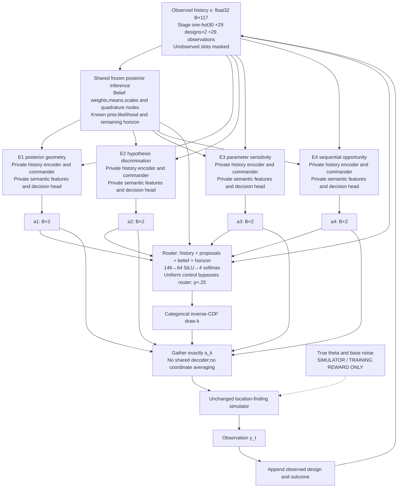

# Categorical MoE-sBOED architectural pilot — seed 101

This isolated pilot tests whether four independent specialist decisions make adaptive routing more useful. It does not replace the completed collaborative benchmark. All results remain pending until the fixed paired run completes.

Each private head receives418 features:private history128,role-first64,role-response64,role-innovation128,belief summary14,horizon1,known prior/noise/bounds13 and likelihood-query summary6. The head is418→128 SiLU→2,followed by4×tanh. It independently produces a valid2D design in[-4,4]^2. No head receives another expert's features or action. The router sees all proposals because it must choose among them;all four proposal computations are paid for.

Only the posterior model is shared. There is no inherited base physical policy,shared history encoder,commander,feature-fusion decoder or action head. Each expert has its own history/command modules. A deterministic posterior centroid is used only to place model queries;it is not a learned shared decision network and is not the executed action. E4's frozen opportunity critic is a private model-derived query provider.

## Training mathematics and chronology

For a history h,the policy executes a single categorical draw k~p_phi(k|h,a1,…,a4) and the simulator receives a_k. It never receives sum_k p_k a_k.

The native actor step for the mixture uses:

L_actor = -mean_h sum_k p_phi(k|h,a1,…,a4) Q_psi(h,a_k).

This is exact enumeration of the categorical critic expectation. Proposal dependence in router inputs is not detached,so expert derivatives include both the direct critic-action gradient and any derivative through the probabilities. Uniform probabilities are literal constants with no gradient. Native sampled categorical target actions give Monte Carlo Bellman backups. No straight-through estimator or gradient through the sampled integer is used.

Only the three-line deterministic native actor branch is replaced in memory with the categorical expectation call. The original native training file is never edited. A source-hashed diff is saved in each mixture run. Native full-horizon variational rewards,posterior training,critic losses,discount1,replay chronology and use_PCE=False stay unchanged. No imitation,diversity,balancing or cost reward is used.

The four experts are first trained as separate full-episode policies with native EIG for200 updates each. Their terminal full-episode EIG is evaluated before router training. Neither expert checkpoints nor hyperparameters are selected using these EIGs;only finite likelihoods,valid physical actions and complete episodes are required. These four pretrained policies then initialize BOTH paired methods. Each method independently trains its private policies for1200 mixture updates. Learned routing trains its router;uniform routing bypasses and freezes its router throughout training,targets and evaluation.

## Locked compute accounting

Each method is charged4×200 shared standalone updates +1200 mixture updates =2000 actor steps,10000 critic steps and300000 posterior optimizer steps. Fresh replay requires10000 episodes per component,so total charged simulation work is2.05M episodes/61.5M observations per method. This is2.5% more new episodes than the earlier2M collaborative continuation;disclose it. Four shared standalone pretraining runs are physically executed once;their full cost is charged to EACH method rather than hidden or amortized away. Costs of inherited semantic/posterior initialization are additional and unchanged across the pair.

The four-hour cap for each method includes its entire charged common pretraining/validation time plus its own mixture training/evaluation time. Fixed terminal schedules are never extended using EIG results. Time-capped runs cannot trigger expansion. Historical collaborative training is reused,not rerun;only its evaluation on the fresh pilot bank is needed. Extracted learned experts are evaluated after mixture training as additional standalone policies,without extra training.

## Evaluation and expansion decision

All primary pilot rows use the SAME new development-validation bank:2000 truth draws,1M prior contrasts,T30,noise sigma.5,same original frozen EIG scorer and chunk16384,common base noise and categorical uniforms. Policies choose different designs and therefore different realized observations. The existing final/reference benchmark bank is not opened. Raw per-case scores support paired differences;case Monte Carlo uncertainty is not training-seed robustness. The development bank is not a final paper test bank.

Compare learned MoE,independently trained fixed-uniform MoE,learned-checkpoint standalone E1–E4 and the existing collaborative learned101 model. Also preserve pre-router standalone scores. The predeclared competitiveness margin is0.1nat relative to the collaborative model. Recommend expansion only if all schedules finish,all standalone interfaces are valid,the learned-minus-uniform95% paired CI lower bound exceeds0,and the learned-minus-collaborative95% CI lower bound exceeds−0.1nat. No five-seed jobs are launched automatically.

## Reproduction

Entry point:`tools/moe_sboed_categorical_pilot.py`.

Configuration:`configs/moe_sboed_categorical_pilot_20261116.json`.

Source:`src/research/moe_sboed_categorical_pilot_20261116/`.

Artifacts:`experiments/location_finding/moe_sboed_categorical_pilot_20261116/`.

`--task smoke` performs CPU tests on disposable in-memory models;`--task controller` starts the sole locked sequential pilot;`--task report` rebuilds tables from saved completed outputs. Do not re-run prepare or launch another controller. Existing component directories are preserved rather than overwritten/retried.
