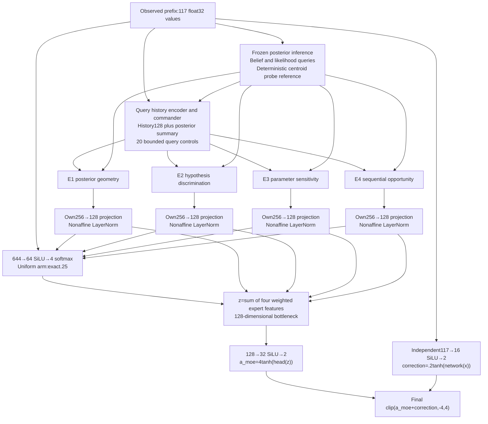

# Expert-dominant MoE-sBOED-V4 — seed101 pilot

All four specialists remain active. No categorical expert-policy selection or averaging of physical design proposals occurs. Router inputs are117 observed-history values,512 normalized expert features,1 remaining-horizon value and14 belief-summary values. No separate policy proposes an action to this router. The action head receives ONLY128 routed expert features.

Each expert preserves its posterior geometry,hypothesis discrimination,Fisher sensitivity or sequential opportunity computations. Its two64-dimensional inherited semantic channels and128-dimensional innovation channel are concatenated,projected256→128 through SiLU,and normalized using its own nonaffine LayerNorm128(eps1e-5). No trainable affine scale is applied after normalization. These feature magnitudes and per-expert action sensitivity are measured during held-out evaluation.

The old complete SG/DAD-like physical policy and large shared decoder are NOT copied into V4. Neither are the old expert-specific decoder projection buffers. The context key named a0 now denotes a deterministic posterior centroid used for internal likelihood-probe placement and query commands;it is not the old learned provisional design,and it never enters the final-action equation. Changing probe reference is an explicit architecture difference,not proof that any resulting performance change is due solely to removing the decoder.

A shared query history encoder and commander remain trainable query machinery. They influence experts through bounded,domain-specific commands. Their unrestricted history representation is NOT concatenated into the MoE action head. This is a retained policy-path dependency,not the weak shared correction network. Frozen posterior and E4 opportunity models remain explicit inference/value providers;the audit rejects all old physical-policy module classes.

The weak branch is exactly117→16 SiLU→2 followed by Tanh. Its only outgoing edge is addition after a_moe with fixed scalar.2. There is no later learned layer,only clipping. It has1922 trainable parameters;the128→32→2 action head has4194. Shared correction cannot exceed.2 per coordinate or be amplified after addition. Its parameters have no effect on expert features,gates or a_moe. Coordinates where its magnitude exceeds a_moe are reported;this can occur when a_moe is near zero without granting the weak branch a large physical action range.

## Verified pretraining audit

CPU tests cover60 histories across all30 stages,finite normalized features,nonzero native-critic gradients for all4 expert groups and router output,gating sensitivity,exact head input,absence of old policy modules,weak-branch perturbation isolation,correction bounds,clipping,future-slot masking,exact uniform weights under adversarial router-parameter changes,paired initial parameter/action equality,and one complete disposable native update per arm.

The router's final layer is initially zero so BOTH arms start with exactly uniform weights and identical actions. Its output-layer gradient is nonzero initially. Its input-layer gradient is initially zero by ordinary chain rule,then becomes nonzero after a disposable test optimizer step. All actual pilot weights remain at their unmodified matched initialization before training. AUDIT_CPU.json records these measurements.

| Arm | Warmup trainable actor parameters | Joint trainable actor parameters | Total actor parameters |
|---|---:|---:|---:|
| MoE-sBOED-V4 |281692|313308|313308|
| MoE-sBOED-V4-uniform |240152|271768|313308|

Difference41540 is precisely the644→64→4 router. Frozen posterior/anchor/opportunity storage includes14911641 buffer elements,reported separately from parameter counts. V4 is NOT capacity matched to V3;the two V4 arms are matched except for intended routing trainability.

## Training and evaluation

Both arms initialize from the same original V2 runtime16001,as did the prior collaborative V3 continuation. There is no inheritance from the terminated categorical pilot or its trained policies. Only copied posterior/query/history/commander/semantic modules are retained;all four feature projections,router,small action head and weak branch are freshly initialized with identical paired values. The native critic,posterior,replay and RNG initialization are matched. Old off-policy replay is inherited equally;it is training data,not a deployed physical-action shortcut.

Run200 warmup updates with query history encoder frozen,then1800 joint updates including that encoder. Four expert pathways,commander/stage offsets,small action head and weak branch train in both phases. The uniform router is frozen and bypassed throughout train,target and evaluation. Adam includes frozen parameters but skips them when grad=None;pre-step gradient checks and frozen-state digests verify no updates.

Use the UNMODIFIED native full-horizon variational actor–critic EIG implementation,discount1,use_PCE=False. No categorical actor-loss patch,no sPCE training and no auxiliary losses/rewards. Each arm receives2000 actor,10000 critic and300000 posterior optimizer steps,2M new episodes/60M observations,and a four-hour total cap including evaluation. No EIG-selected checkpoint or selective training extension is allowed.

All four comparison rows are rerolled on one new held-out development-validation bank:V4learned,V4uniform,previous collaborative learned101,and previous independently trained uniform101. Same2000 parameter draws,base observation noise,1M contrasts,T30,sigma.5,bounds[-4,4]^2,frozen original scorer and chunk16384. The original benchmark test bank is not opened or modified. Terminal checkpoints only. This one-seed pilot does not establish across-seed robustness.

Diagnostics save stage routing means/history standard deviations,normalized feature RMS,training router/expert gradient norms,action changes when each gate is shifted10% toward that expert,weak/main magnitudes,clipping and shared-dominance fractions. Different gate weights alone are not EIG evidence.

Recommend considering additional seeds only if learned-minus-uniform paired95% CI has lower bound>0 and learned-V4 minus previous learned has lower bound>−.1nat. No five-seed jobs launch automatically. If competitive performance or routing evidence fails,report failure and stop this pilot;no broad architecture search.

## Files

Source:src/research/moe_sboed_v4_20261116/{policy.py,specialist_queries.py,run.py}.

Entry point:tools/moe_sboed_v4_pilot.py.

Common locked protocol:configs/moe_sboed_v4_20261116.json;resolved per-arm launch configurations are also saved under configs. Actual run configurations are written to each arm's CONFIG.json.

Artifacts:experiments/location_finding/moe_sboed_v4_20261116/. Each arm saves warmup_actor.pt,joint_actor.pt,runtime.pkl,TRAINING_METRICS.jsonl,phase receipts,resource samples,evaluation/scores.npy and evaluation/diagnostics.npz. Existing checkpoints and terminated-pilot artifacts remain untouched.

Reports:reports/moe_sboed_v4_20261116/{ARCHITECTURE.md,AUDIT_CPU.json,RESULTS.md,RESULTS.json,DIAGNOSTICS.json}. Results remain explicitly pending until runs finish. Expansion is a recommendation,not an automatic queue.
