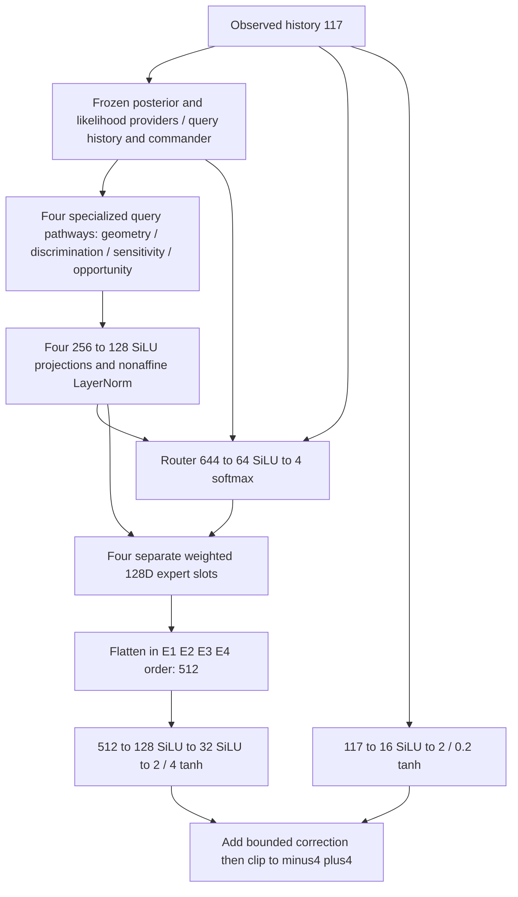

# Matched MoE-sBOED V5 seed101 pilot

V5 inherits `V4Actor` query, inference, commander, four specialist pathways, projections, nonaffine LayerNorm, 644→64→4 router, observed-prefix masking and bounded weak branch. It overrides only the action-head construction and `decode`. No V4-Spec gradient allocation is imported. No V2 complete-design policy is retained or executed. The V2-derived `StudyMoE` constructor is a temporary parameter-transplant adapter only; its policy is never executed. Query probes use a deterministic posterior centroid, not a pretrained policy action.

V4 sums the four features before its 128→32→2 head. V5 preserves their weighted identities and changes head capacity to 512→128→32→2 (69,858 head parameters versus 4,194). A gain cannot distinguish slot preservation from head capacity. No postrouting normalization or history concatenation is present. All experts execute; physical actions are neither averaged nor selected categorically.

Both methods start afresh from the original frozen V2 runtime at native update16001, not a trained V4/Spec continuation. The original V4 random module recipe is run first, then only its action head is replaced. Thus every common non-head initialization is bitwise identical to the original V4 seed101 recipe. Learned and uniform initial actors/actions match exactly. The router output layer is zero. Each arm independently receives original200 warmup plus1800 joint updates:2000 actor,10000 critic,300000 posterior optimizer updates;2M new episodes and60M observations. This is the original native variational actor–critic objective with discount1/use_PCE=False;the warmup only freezes the query-history encoder,not regime-selected gradients. Inherited replay and all critic/posterior/optimizer/RNG fingerprints are recorded before training. Uniform bypasses and freezes its router for online/target/evaluation policy execution.

One new fixed development bank:seed202611185501;2000 cases,1M contrasts,T30,sigma.5,normal prior,original scorer and[-4,4]^2. All five policies use common truth/base noise/contrasts,not identical observations. Terminal2000 checkpoints only,no test selection. V4 learned/uniform and vsOED are reevaluated without training. Four-hour hard caps include initialization,serialization and evaluation. Native optimizer and simulator receipts,5-second utilization samples and synchronized batch16 forward timing are saved. Batch-amortized timing is not batch1 latency. Frozen provider/V2 pretraining is inherited,not free;historical costs unavailable in this pilot must be disclosed. Disposable CPU audit native updates use2×4 episodes and are preparation costs,not formal training.

Primary paired comparison:V5 learned minus original V4 learned. Secondary:learned minus independently trained uniform;V5 minus vsOED;uniform V5 minus V4. Report95% paired case t intervals,n=2000;one continuation seed is not training-seed robustness. No automatic seeds102–105. Do not treat a larger routing gap caused by uniform deterioration as success.

The1M estimator has known finite-contrast saturation. Before training,lock ONE optional diagnostic:if primary pairedCI lower>0 and V5 routing-gap mean>=0,evaluate first256 cases of this same new bank for ALL five policies using nested1M/4M contrasts(extension seed202611185502). No tuning/checkpoint selection. Require remaining time under each new arm cap;charge the full diagnostic time conservatively to each arm. Otherwise record not-triggered/insufficient-budget. Existing canonical bank is never used for V5 selection.

Run `tools/moe_sboed_v5_20261118.py --task prepare`,then CPU `--task audit`,then exactly one durable `--task controller`. Never rerun prepare or overwrite existing run directories. The controller waits for unrelated GPU jobs,uses the established resource lease,runs learned→uniform→original V4 learned→original V4 uniform→vsOED→conditional sensitivity sequentially,and preserves failure without automatic retraining. Reports and raw score/checkpoint paths are separated;large artifacts stay out of Git.
