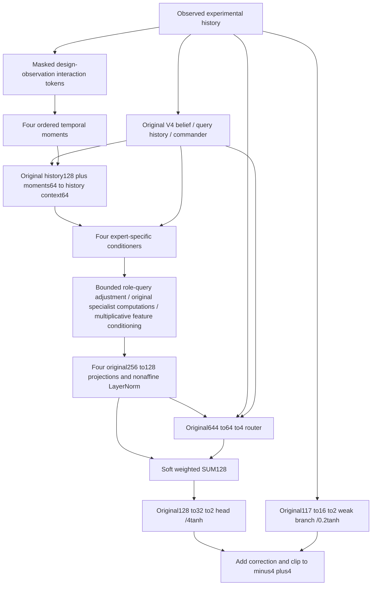

# Replacement MoE-sBOED V5:history-conditioned soft collaboration

Official methods: **MoE-sBOED V5** and **MoE-sBOED V5-uniform**. Provenance suffix `history_20261119` separates this implementation from the retired `moe_sboed_v5_20261118` expert-slot/large-head experiment. That prior implementation,checkpoints and negative results remain unchanged and must not be restarted. Existing V2,V3,V4 and V4-Spec artifacts are preserved.

## Architecture

All four feature experts execute. They are complementary feature providers,not required to be individually competent standalone policies. Scientific roles remain posterior geometry,hypothesis discrimination,parameter sensitivity and sequential opportunity. Existing domain-model queries are preserved;no common candidate grid is introduced. The history architecture uses experimental design-observation pairs and chronology;its input adapter here has design dimension2,observation dimension1 and horizon30 because this pilot uses the unchanged location-finding problem. Other problems require their own validated input/model adapters,not copied physical dimensions.

For each completed pair,the8 channels are design2/4,tanh(observation/5),their2 interaction products,observation increment1,and design increment2. Map8→16SiLU. Pool four masked temporal moments:constant,absolute position,cosine position,and exponential recency(scale5 steps). Concatenate the64 moment entries with the original128-dimensional query-history encoding;192→64SiLU gives shared history context. This is a lossy compact history representation,not an exact recurrent belief filter. Original ordered history and current belief remain available. Exact sequences of posterior transitions are not computed or claimed.

Each expert separately receives context64,belief summary14,remaining horizon1 and its original role command4/6/6/4. A32-wideSiLU conditioner outputs a role-command adjustment plus256 per-channel gains. Final conditioner layers start exactly zero. The command becomes `cmd + .25*tanh(delta)*(1-abs(cmd))`,within[-1,1]. The original256 specialist feature is multiplied by `1+.5*tanh(gain)`,within[.5,1.5],before its existing projection/LayerNorm. This conditions both the scientific query and feature interpretation on history. No additive history embedding reaches the action head. No feature-slot concatenation,no larger decoder,no SGActor,no inherited complete-design teacher policy.

V4's router remains644→64SiLU→4softmax,with zero-initialized output layer. It sees raw observed history,the four now-history-conditioned normalized features,remaining horizon and belief summary. Uniform bypasses and freezes that router at exactly.25 for online,target and evaluation execution. No direct supervision or auxiliary objectives are added.

## Matched protocol

Original V4 seed101 initialization from frozen V2 runtime16001;no trained V4,retired V5 or V4-Spec policy initialization. All812 original state tensors and original initial policy actions match V4 exactly;new adapters start neutral. Both arms have identical actor,target,critic,posterior,optimizer,replay and training-RNG initialization. The full runtime and fingerprints are saved. Original native full-horizon variational actor–critic objective,discount1,use_PCE=False. Original200 warmup freezes original query-history encoder;new history/context/conditioners train normally. Original1800 joint updates unfreeze that encoder. No gradient masks,no specialization warmup,no teacher or new reward.

Each arm:2000 actor,10000 critic,300000 posterior optimizer updates;2M new episodes,60M observations. Each independently trains its full budget. Four-hour hard cap includes initialization,serialization and evaluation;no selective extension. Native receipts and measured resources are retained. Additional disposable CPU audit updates use8 total episodes,reported separately. Inherited provider/pretraining and1M replay are shared dependencies,not free from-scratch computation.

## Audit and evaluation

Before training:all experts active,128D normalized features,128D weighted sum,head bounded/isolated,uniform invariant to router perturbation,paired initial equality,exact V4 initial equality,future-prefix poisoning invariance,finite native gradients,history gradients after neutral initialization,and observation/order sensitivity. A controlled zero-history-context intervention after disposable native-critic updates changes all four feature outputs,router weights and actions. This proves computation paths,not increased EIG or useful adaptive decisions.

New bank seed202611195101:2000 trajectories,1M contrasts,T30,sigma.5,original frozen scorer,prior and bounds. Common underlying truth/noise,not identical realized observations. Evaluate both new arms and frozen original V4 learned/uniform and vsOED101. No retraining controls,canonical-bank selection or checkpoint tuning. Only terminal2000 checkpoints. Primary:V5 learned minus original V4 learned;secondary:learned minus independently trained uniform and vsOED;also uniform V5 minus V4. Report paired95% case t intervals separately from seed variability(one continuation seed only). Positive routing/gradient variation is not a success metric.

Known1M-contrast estimator saturation is a limitation. Prespecified optional sensitivity:only if primary pairedCI lower>0 and new routing-gap mean>=0,evaluate all five policies on first256 cases using nested1M/4M contrasts,extension seed202611195102. Require remaining cap;charge full sensitivity time conservatively to each new arm. Otherwise record not-triggered/skipped. No model changes follow these scores.

No automatic seeds102–105. Recommend expansion only for credible absolute-EIG potential without uniform deterioration;otherwise stop. History encoder and expert conditioning are one package,so individual causal effects are not identified. V4 fusion/head capacities are unchanged;extra expert/history parameters and query/compute costs must be disclosed.

Source/config/reports are committed from LabPC through GitHub to the clean Ubuntu worker. Large checkpoints,banks and per-case arrays remain in the main LabPC project,outside Git. The controller executes learned→uniform→original V4 learned→original V4 uniform→vsOED→conditional sensitivity sequentially with the established resource lease,preserves failures,and never retries automatically.
