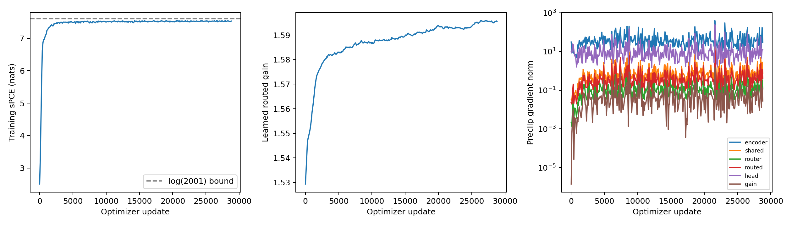
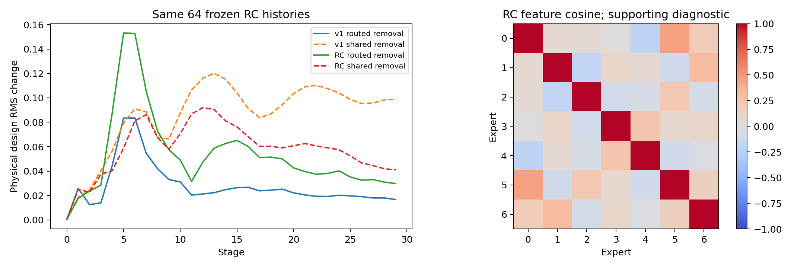
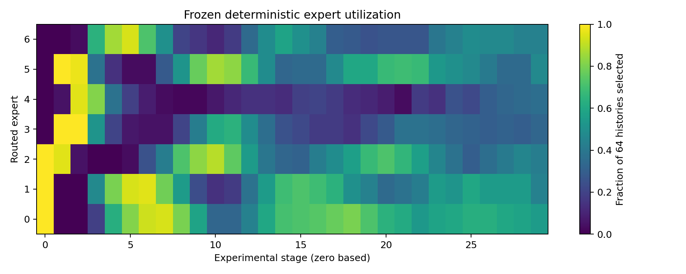
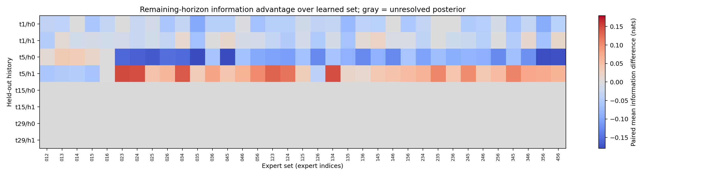

# Expert contribution and information specialization

## Routing and contribution

Learned minus uniform random-subset routing: **+0.027507 +/- 0.085894 nats** on256 development trajectories/L262144, averaged over3 fixed routing draws.
Learned minus uniform weights on the same selected set: **-0.033075 +/- 0.026400**.
Full minus routed-masked policy: **+0.063981 +/- 0.096595**.
Uncertainty is paired trajectory MC SE conditional on the fixed banks and finite routing replicates.

On identical64 RC-generated development histories, local routed-removal physical design RMS changes from0.02776250 for v1 to0.05287469 for RC.
Shared removal: v10.08536429, RC0.05829974.
Calibrated routed feature norm: v10.08876321, RC0.17348185.
These comparisons describe frozen trained functions on shared inputs; they do not alone establish useful information specialization.

Final frozen gain: **1.59543546**. Selected-checkpoint charged training time: **14398.387s**. Complete primary training trajectories: **57,704,000**. Measured training parameter-stage propagations: **3,463,971,120,000**.

Development EIG (same256 truth/noise cases and262144 contrasts):

| Policy/intervention | Mean EIG | MC SE |
|---|---:|---:|
|full|10.59421841|0.10912120|
|uniform_weights|10.62729344|0.10700949|
|uniform_subset|10.56671177|0.09850414|
|mask_routed|10.53023738|0.10816581|
|v1|10.82904733|0.09954094|
|dense|10.90328313|0.09854584|

Additional user-supplied reference means (descriptive; raw pairing not reverified here):

| Reference | EIG | RC minus supplied mean |
|---|---:|---:|
|PIMoE-IC|11.88809|-1.064830|
|MoE-v2|11.04023|-0.216970|

## Conditional information competence

**Useful context-dependent specialization: NOT YET ESTABLISHED.**
Usable finite posterior references: 4/8. Familywise screened alternative wins: 0.
All35 triples were compared using the same prefix, paired posterior draws/noise and common deterministic continuation. Two262144-prior-particle importance references must both have ESS>=128. Each uses32 fantasies and65536 posterior contrasts. Low-ESS middle/late rows are withheld, never treated as zero advantage. Independent banks expose sensitivity; ESS is not a convergence certificate, and fantasy MC SE does not fully include posterior-approximation error. Eight prefixes derive from only two generating trajectories. This small audit cannot establish broad contextual specialization.

