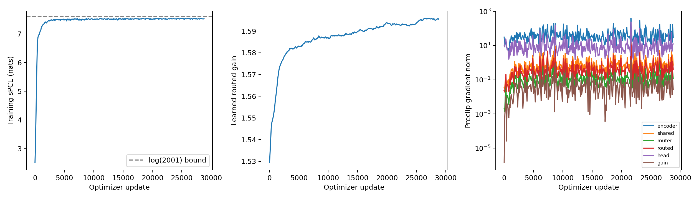
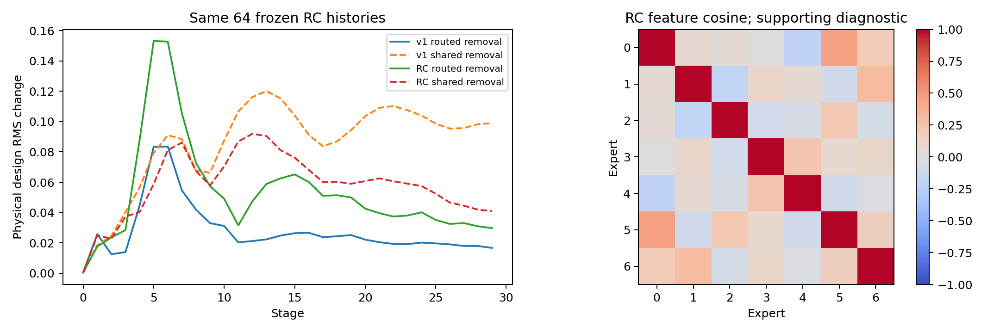
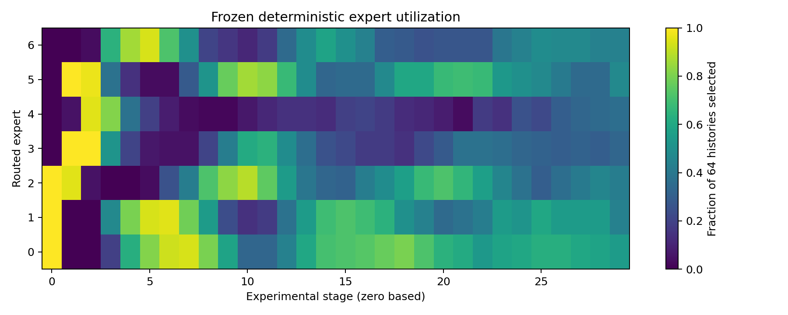
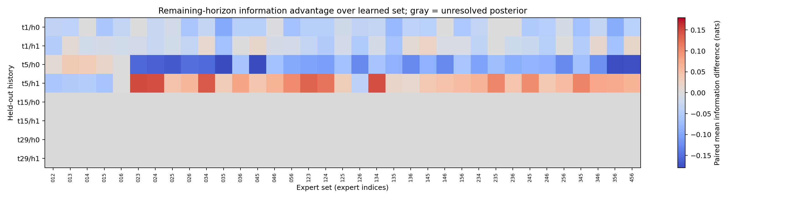

# DeepSeekMoE-sBOED-RC: seed101

Official EIG: **10.823260 +/- 0.045184 nats** (trajectory MC SE).
Independent confirmation: **10.869583 +/- 0.044043**, seed96251007.
One training seed; neither standard error measures variability across training seeds.

| Reference | EIG | RC minus reference | Paired MC SE |95% CI |
|---|---:|---:|---:|---|
|IR_MoE|10.815467|+0.007793|0.052988|[-0.09606438588233435, 0.11165034086896819]|
|vsOED|12.480847|-1.657587|0.057194|[-1.7696875433503791, -1.5454861090220948]|
|DeepSeekMoE_v1|10.989066|-0.165806|0.048585|[-0.2610329902608122, -0.07057868438482677]|
|corrected_DAD|10.276113|+0.547147|0.055815|[0.4377494911455104, 0.6565449080655628]|

Exact canonical truth, observation noise, trajectory order and contrast bank were verified. All paired results use2000 per-trajectory differences; they are not inferred from standalone standard errors. Seed1001 is a consumed historical benchmark. Confirmation was reserved before training. No model was retuned or replaced after official evaluation.

## Implementation and tests

One bounded learned scalar: g=0.25+3.75 sigmoid(a), initialized to1.5293153966 from32 fresh training-only histories. Architecture remains one shared width8 expert, seven routed width8 experts and top3, shared sum encoder/head.8435 total parameters,6899 activated. Selected full-softmax mass retained. Deterministic v1 routing,2,000 contrasts and original simulator/prior/likelihood/bounds/H30 are unchanged.

19 CPU/regression checks passed. Two full B2000/L2000/H30 GPU smoke updates passed; finite nonzero gain/shared/router/routed gradients, valid designs and swap sensitivity. No numerical correction to the v1 objective, routing or optimizer was made. The seed-audit substring false positive was repaired before any main update; its attempt is preserved.

## Routing and contribution

Learned minus uniform random-subset routing: **+0.027507 +/- 0.085894 nats** on256 development trajectories/L262144, averaged over3 fixed routing draws.
Learned minus uniform weights on the same selected set: **-0.033075 +/- 0.026400**.
Full minus routed-masked policy: **+0.063981 +/- 0.096595**.
Uncertainty is paired trajectory MC SE conditional on the fixed banks and finite routing replicates.

On identical64 RC-generated development histories, local routed-removal physical design RMS changes from0.02776250 for v1 to0.05287469 for RC.
Shared removal: v10.08536429, RC0.05829974.
Calibrated routed feature norm: v10.08876321, RC0.17348185.
These comparisons describe frozen trained functions on shared inputs; they do not alone establish useful information specialization.

Final frozen gain: **1.59543546**. Selected-checkpoint charged training time: **14398.387s**. Complete primary training trajectories: **57,704,000**. Measured training parameter-stage propagations: **3,463,971,120,000**.

Development EIG (same256 truth/noise cases and262144 contrasts):

| Policy/intervention | Mean EIG | MC SE |
|---|---:|---:|
|full|10.59421841|0.10912120|
|uniform_weights|10.62729344|0.10700949|
|uniform_subset|10.56671177|0.09850414|
|mask_routed|10.53023738|0.10816581|
|v1|10.82904733|0.09954094|
|dense|10.90328313|0.09854584|

Additional user-supplied reference means (descriptive; raw pairing not reverified here):

| Reference | EIG | RC minus supplied mean |
|---|---:|---:|
|PIMoE-IC|11.88809|-1.064830|
|MoE-v2|11.04023|-0.216970|

## Conditional information competence

**Useful context-dependent specialization: NOT YET ESTABLISHED.**
Usable finite posterior references: 4/8. Familywise screened alternative wins: 0.
All35 triples were compared using the same prefix, paired posterior draws/noise and common deterministic continuation. Two262144-prior-particle importance references must both have ESS>=128. Each uses32 fantasies and65536 posterior contrasts. Low-ESS middle/late rows are withheld, never treated as zero advantage. Independent banks expose sensitivity; ESS is not a convergence certificate, and fantasy MC SE does not fully include posterior-approximation error. Eight prefixes derive from only two generating trajectories. This small audit cannot establish broad contextual specialization.

## Compute, latency and locations

Executed updates28852; selected28852; stopcompute_budget_exhaustion. Four-hour charged main-training allowance. Actual complete ledgers are cost_full_final.json and cost_full_progress.json. True/contrast parameter-stage propagations are distinguished from Python simulator invocations; these counters are not physical experiments. Native calibration, smoke, held-out validation/evaluation, conditional competence and matched-history audit have separate measured timing/counters. Exact GPU-kernel busy time and CPU-test simulator counts were not instrumented and are not fabricated.

Online inference: mean0.579518ms, p950.591471ms for300 synchronized batch1 forwards. Deployment only uses frozen network inference, with no teacher, simulation, candidate search or numerical optimization.

Checkpoint: /home/grads/g/g.lin/Documents/objective_power_grid_deepseek_rc/experiments/10252026/10252026_deepseek_rc_seed101/models/full/selected.pt
SHA256: 6c3623c915c0fb58431ce80a5fabc4da307d49b101a314fffa329a2b8317664b
Source: ad330a26ce28e98c53eab25c5a3e41a35f6ad4de
Branch: research/deepseekmoe-routed-calibration
Raw campaign: /home/grads/g/g.lin/Documents/objective_power_grid_deepseek_rc/experiments/10252026/10252026_deepseek_rc_seed101
Portable report evidence: reports/deepseek_rc_seed101_evidence/

## Limits

Training mean sPCE approaches the theoretical log(2001) ceiling; this is consistent with finite-contrast saturation, not proof of the only performance bottleneck. Global norm5 clipping was preserved; 100.0% of logged updates exceeded it. The history encoder dominates gradient magnitude. Standard deterministic hard-top3 retains v1's piecewise autograd convention; no claim of an unbiased gradient across dispatch boundaries is made.

Dense development comparison is descriptive: slightly different parameter count, throughput backend and50k schedule completing before its4h allowance. Frozen branch removals are not retrained controls. Increased routed norms or action influence do not imply better designs or specialization. No claim to beat vsOED is made without the measured paired evidence above.
