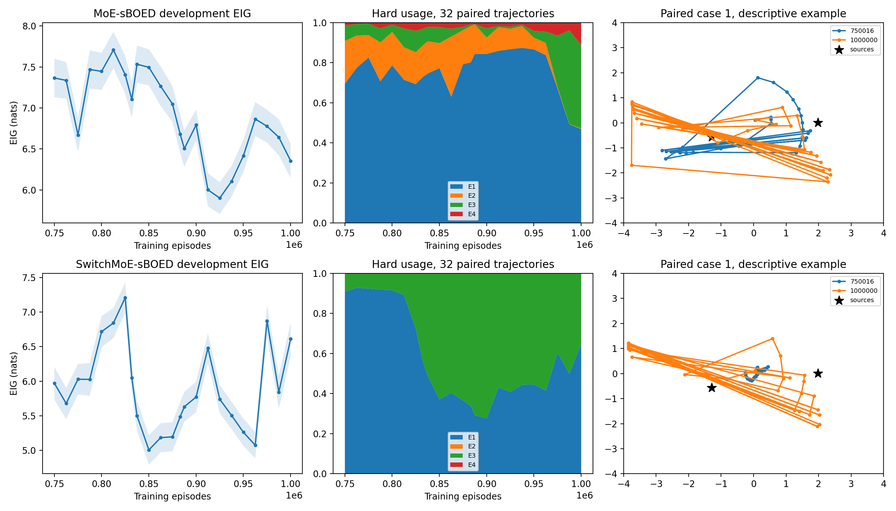

# Seed-103 late-stage MoE root-cause report

## Conclusion

The strongest supported localization is **encoder–router–expert interaction**, with different contributions at onset and at the final checkpoint. A router-only failure, an encoder-only defect, a first-design defect, and a switching-gate hard-decision failure are not sufficient explanations. The saved snapshots establish behavioral sensitivity to multiple components; they do not uniquely identify the original training-time causal chain.

The early relaxed policy substantially outperforms its hard deployment, while late sharpening coincides with loss of relaxed-policy quality and redistribution of hard expert choices. This supports a train/deployment alignment hypothesis, but does not establish that gamma itself is defective. Raw gradient spikes are real; exploding Adam parameter updates are not established.

## Scope, reproducibility and integrity

No training was launched for this analysis. No architecture, optimizer, gamma, clipping, budget or random-seed setting was modified. All 46 dense checkpoints passed their saved SHA-256 checks; original final checkpoint hashes remain unchanged. The instrumented reproductions had already reproduced both original final checkpoints bitwise. Primary five-seed results were not replaced. Reserved evaluation seed 8831001 was not used.

Late checkpoint evaluation uses the existing common explicit-likelihood scorer: 512 paired development cases, L=1,000,000, seed 771001. These are diagnostic validation draws, not the historical 2,000-case seed-1001 result or final test results. All swaps and hard/relaxed comparisons use the same truth, Gaussian noise and contrast bank. Paired-draw hash: `fab6dcd9f8005663ca1473e97639594120b3ccc71ce31cb0f4ed410cedab44ba`.

Uncertainty intervals below are unadjusted trajectory-level normal Monte Carlo intervals (mean ± 1.96 paired SE). They do not measure across-training-seed variability. Onset screening and swaps are exploratory, with multiple comparisons; they are not confirmatory significance tests.

## Earliest sustained late deterioration

Descriptive onset rule, specified before component interventions: the first saved checkpoint at least 0.3 nats below an earlier running peak, with a negative paired 95% upper limit, sustained for three consecutive saved checkpoints. This rule does not establish an exact change point or the onset of the entire seed failure before 750k.

| Method | Earlier peak / episodes | First sustained drop / episodes | First paired change [95% interval] | Final diagnostic EIG |
|---|---|---|---|---|
| MoE-sBOED | 7.70751 / 812,544 | 7.26450 / 862,528 | -0.44301 [-0.66161, -0.22441] | 6.35474 |
| SwitchMoE-sBOED | 7.20749 / 825,024 | 6.04787 / 832,000 | -1.15962 [-1.37804, -0.94120] | 6.60984 |

MoE has an earlier transient dip at 775,040 episodes followed by recovery; it is not classified as sustained. Its sustained decline is bracketed by 850,048–862,528 episodes, earlier than the previously observed 883k training-bound deterioration. SwitchMoE declines between 825,024–832,000, but later rebounds (6.87227 at 975,040 and 6.60984 at 1M); it is not a monotonic collapse.

Both hard policies are already weak at 750k (7.36520 and 5.97208). Consequently, late deterioration alone cannot explain the complete gap to successful training seeds. Historical final seed-1001 EIG remains 6.25322 / 6.50948; the different diagnostic values reflect a different development population.

## Controlled component interventions

Restore: replace only the named later-checkpoint component(s) with the earlier anchor weights. Reverse: insert later component weights into the earlier anchor policy. All other weights, first-design handling and action mapping remain fixed. These hybrids may encounter out-of-distribution representations and expert histories. Effect magnitudes are not additive component contributions or definitive causal attributions.

| Method | Intervention | Destination ← donor episodes | Component(s) | EIG | Change vs destination [95% interval] |
|---|---|---|---|---:|---|
| MoE-sBOED | early_restore | 862,528 ← 812,544 | router | 7.75854 | +0.49405 [+0.32264, +0.66545] |
| MoE-sBOED | early_restore | 862,528 ← 812,544 | experts | 7.41300 | +0.14850 [+0.00182, +0.29517] |
| MoE-sBOED | early_restore | 862,528 ← 812,544 | encoder | 7.56772 | +0.30322 [+0.13746, +0.46899] |
| MoE-sBOED | early_restore | 862,528 ← 812,544 | first_design | 7.26376 | -0.00074 [-0.04243, +0.04095] |
| MoE-sBOED | early_restore | 862,528 ← 812,544 | encoder+router | 7.85680 | +0.59230 [+0.38509, +0.79951] |
| MoE-sBOED | early_restore | 862,528 ← 812,544 | encoder+experts | 7.66424 | +0.39974 [+0.21791, +0.58157] |
| MoE-sBOED | early_restore | 862,528 ← 812,544 | router+experts | 7.75729 | +0.49279 [+0.28116, +0.70443] |
| MoE-sBOED | early_reverse | 812,544 ← 862,528 | router | 7.63568 | -0.07183 [-0.24633, +0.10267] |
| MoE-sBOED | early_reverse | 812,544 ← 862,528 | experts | 7.85413 | +0.14662 [+0.00099, +0.29225] |
| MoE-sBOED | early_reverse | 812,544 ← 862,528 | encoder | 7.72748 | +0.01998 [-0.15429, +0.19424] |
| MoE-sBOED | final_restore | 1,000,000 ← 812,544 | router | 6.64964 | +0.29491 [+0.16490, +0.42492] |
| MoE-sBOED | final_restore | 1,000,000 ← 812,544 | experts | 7.34397 | +0.98923 [+0.78969, +1.18876] |
| MoE-sBOED | final_restore | 1,000,000 ← 812,544 | encoder | 6.47977 | +0.12503 [-0.03807, +0.28813] |
| MoE-sBOED | final_restore | 1,000,000 ← 812,544 | first_design | 6.35642 | +0.00169 [-0.03510, +0.03847] |
| MoE-sBOED | final_restore | 1,000,000 ← 812,544 | encoder+router | 6.86776 | +0.51302 [+0.33447, +0.69156] |
| MoE-sBOED | final_restore | 1,000,000 ← 812,544 | encoder+experts | 7.55517 | +1.20043 [+0.98552, +1.41533] |
| MoE-sBOED | final_restore | 1,000,000 ← 812,544 | router+experts | 7.09744 | +0.74270 [+0.52763, +0.95776] |
| SwitchMoE-sBOED | early_restore | 832,000 ← 825,024 | router | 6.35470 | +0.30683 [+0.17768, +0.43598] |
| SwitchMoE-sBOED | early_restore | 832,000 ← 825,024 | experts | 6.73111 | +0.68324 [+0.53711, +0.82936] |
| SwitchMoE-sBOED | early_restore | 832,000 ← 825,024 | encoder | 6.53320 | +0.48533 [+0.34250, +0.62815] |
| SwitchMoE-sBOED | early_restore | 832,000 ← 825,024 | first_design | 6.04783 | -0.00004 [-0.00909, +0.00901] |
| SwitchMoE-sBOED | early_restore | 832,000 ← 825,024 | switching_gate | 6.04787 | +0.00000 [+0.00000, +0.00000] |
| SwitchMoE-sBOED | early_restore | 832,000 ← 825,024 | encoder+router | 6.77016 | +0.72229 [+0.55269, +0.89188] |
| SwitchMoE-sBOED | early_restore | 832,000 ← 825,024 | encoder+experts | 7.05429 | +1.00642 [+0.82702, +1.18583] |
| SwitchMoE-sBOED | early_restore | 832,000 ← 825,024 | router+experts | 6.93041 | +0.88254 [+0.70378, +1.06129] |
| SwitchMoE-sBOED | early_reverse | 825,024 ← 832,000 | router | 7.06226 | -0.14523 [-0.28789, -0.00256] |
| SwitchMoE-sBOED | early_reverse | 825,024 ← 832,000 | experts | 6.75830 | -0.44919 [-0.61244, -0.28595] |
| SwitchMoE-sBOED | early_reverse | 825,024 ← 832,000 | encoder | 6.92672 | -0.28077 [-0.44002, -0.12152] |
| SwitchMoE-sBOED | final_restore | 1,000,000 ← 825,024 | router | 6.62695 | +0.01711 [-0.18812, +0.22234] |
| SwitchMoE-sBOED | final_restore | 1,000,000 ← 825,024 | experts | 6.40421 | -0.20563 [-0.38248, -0.02878] |
| SwitchMoE-sBOED | final_restore | 1,000,000 ← 825,024 | encoder | 6.81477 | +0.20494 [+0.02571, +0.38416] |
| SwitchMoE-sBOED | final_restore | 1,000,000 ← 825,024 | first_design | 6.61586 | +0.00602 [-0.01121, +0.02326] |
| SwitchMoE-sBOED | final_restore | 1,000,000 ← 825,024 | switching_gate | 6.60984 | +0.00000 [+0.00000, +0.00000] |
| SwitchMoE-sBOED | final_restore | 1,000,000 ← 825,024 | encoder+router | 7.21072 | +0.60088 [+0.36401, +0.83776] |
| SwitchMoE-sBOED | final_restore | 1,000,000 ← 825,024 | encoder+experts | 6.62332 | +0.01349 [-0.18927, +0.21624] |
| SwitchMoE-sBOED | final_restore | 1,000,000 ← 825,024 | router+experts | 6.83568 | +0.22584 [+0.04252, +0.40915] |

At MoE onset, restoring the router or encoder improves EIG, but neither later component alone clearly harms the earlier policy in the reverse test. The later experts can even improve that earlier policy. This argues for context-dependent interaction rather than intrinsically bad router or expert weights. By the final MoE checkpoint, restoring earlier experts provides a larger recovery than restoring the router alone.

SwitchMoE onset likewise depends on multiple components. Its first-design swap is negligible and the switching-gate swap has exactly zero hard-EIG effect. All saved 32-case hard routing probes request rerouting at every routed decision; temporal persistence is not demonstrated.

## Fixed-history decomposition

Compare all checkpoints on the same 928 observable stage/case histories (29 routed stages × 32 anchor trajectories). Router-only and encoder-only sign flips keep the other component fixed. Expert-only proposal changes use the anchor context; encoder-only proposal changes use anchor experts. Values are averages across all experts, not necessarily selected-action changes. The measurements are counterfactual probes, not rollout EIG.

| Method | Episodes | Hard proposal-selection change | Router-only bit flips | Encoder-only bit flips | Expert-only design change | Encoder-only design change | Combined design change |
|---|---:|---:|---:|---:|---:|---:|
| MoE-sBOED | 862,528 | 33.7% | 15.2% | 8.3% | 0.2181 | 0.1497 | 0.3208 |
| MoE-sBOED | 883,200 | 21.3% | 15.1% | 10.2% | 0.1601 | 0.3463 | 0.3878 |
| MoE-sBOED | 1,000,000 | 49.4% | 17.2% | 14.3% | 0.6087 | 0.4432 | 0.8949 |
| SwitchMoE-sBOED | 832,000 | 39.5% | 13.5% | 6.1% | 0.1517 | 0.0840 | 0.2149 |
| SwitchMoE-sBOED | 883,200 | 71.3% | 30.3% | 28.4% | 0.4534 | 0.4729 | 0.6268 |
| SwitchMoE-sBOED | 1,000,000 | 47.6% | 26.8% | 8.9% | 0.3847 | 0.2383 | 0.4724 |

Small weight displacement can change many threshold-based routing decisions. At the first sustained drop, relative router / encoder / expert displacements are respectively MoE-sBOED: 0.206%/0.461%/0.983%; SwitchMoE-sBOED: 0.126%/0.443%/0.657%. This is not evidence of a large parameter-norm explosion.

## Gradients, saturation and actual Adam updates

Gradient norms are measured before component clipping; actual parameter increments are measured after Adam. Saturation means abs(selector logit) ≥ gamma/2. Gradient exposure means norm > 1e-8; negligible means ≤ 1e-12. Quantile ordering in JSON is min / p10 / p50 / p90 / p99 / max. Each window includes every saved training update, not just periodic console rows.

| Method | Episode window | Median saturated bits | Median raw router gradient | Median router parameter step | Median encoder step | Router negligible-gradient updates |
|---|---|---:|---:|---:|---:|---:|
| MoE-sBOED | 750000-825000 | 43.76% | 136.82 | 7.2156e-05 | 0.00088727 | 0.00% |
| MoE-sBOED | 825000-850000 | 47.60% | 1627.9 | 7.1919e-05 | 0.00088288 | 0.00% |
| MoE-sBOED | 850000-883200 | 59.33% | 11474 | 6.4903e-05 | 0.00089595 | 0.00% |
| MoE-sBOED | 883200-950000 | 96.05% | 3.162e+05 | 6.1927e-05 | 0.00076468 | 0.00% |
| MoE-sBOED | 950000-1000001 | 99.49% | 6516 | 6.6675e-05 | 0.00087662 | 0.00% |
| SwitchMoE-sBOED | 750000-825000 | 55.02% | 167.2 | 6.9288e-05 | 0.00091331 | 0.00% |
| SwitchMoE-sBOED | 825000-850000 | 78.39% | 1.5485e+06 | 5.9198e-05 | 0.0009491 | 0.00% |
| SwitchMoE-sBOED | 850000-883200 | 90.50% | 1.2457e+06 | 4.6539e-05 | 0.00079087 | 0.00% |
| SwitchMoE-sBOED | 883200-950000 | 98.71% | 32961 | 4.1534e-05 | 0.00082023 | 0.00% |
| SwitchMoE-sBOED | 950000-1000001 | 99.73% | 4735 | 4.6565e-05 | 0.0008818 | 0.13% |

Raw router gradients increase sharply during sharpening, but the median router Adam increment does not increase accordingly. Thus raw gradient explosion cannot be equated to optimizer-step explosion. Near-complete selector saturation also does not imply a completely dead router: a small unsaturated subset can retain large gradients.

| Method | Episode window | E1 gradient exposure | E2 | E3 | E4 |
|---|---|---:|---:|---:|---:|
| MoE-sBOED | 750000-825000 | 100.00% | 100.00% | 100.00% | 100.00% |
| MoE-sBOED | 825000-850000 | 100.00% | 100.00% | 100.00% | 100.00% |
| MoE-sBOED | 850000-883200 | 100.00% | 100.00% | 100.00% | 100.00% |
| MoE-sBOED | 883200-950000 | 100.00% | 100.00% | 100.00% | 100.00% |
| MoE-sBOED | 950000-1000001 | 100.00% | 70.08% | 100.00% | 100.00% |
| SwitchMoE-sBOED | 750000-825000 | 100.00% | 100.00% | 100.00% | 100.00% |
| SwitchMoE-sBOED | 825000-850000 | 100.00% | 100.00% | 100.00% | 100.00% |
| SwitchMoE-sBOED | 850000-883200 | 100.00% | 39.77% | 100.00% | 39.96% |
| SwitchMoE-sBOED | 883200-950000 | 100.00% | 0.00% | 100.00% | 0.00% |
| SwitchMoE-sBOED | 950000-1000001 | 100.00% | 0.00% | 100.00% | 0.00% |

The JSON key `gradient_exposure_gt1e8` in this diagnostic export means norm > 1e-8 (the key omits the minus sign); the threshold used by the computation is 1e-8. Hard inference use and relaxed training exposure are distinct. SwitchMoE E2/E4 starvation is evident, but those experts were already largely inactive before the observed late drop. It does not by itself establish the cause of the abrupt decline.

## Physical measurement behavior and history feedback

The following are paired 32-case, all-stage descriptive probes, not full-population uncertainty estimates. True-source distance is a secondary geometry descriptor; it is neither a training loss nor a substitute for EIG.

| Method | Episodes | E1/E2/E3/E4 use | Expert changes/episode | Mean measurement step | Coordinates abs(x)>3.8 | Mean nearest-source distance |
|---|---|---|---:|---:|---:|---:|
| MoE-sBOED | 812,544 | 71.4%/16.3%/9.4%/2.9% | 9.00 | 1.3251 | 0.00% | 1.2946 |
| MoE-sBOED | 862,528 | 63.0%/30.0%/4.0%/3.0% | 5.66 | 0.8709 | 0.00% | 1.5302 |
| MoE-sBOED | 883,200 | 80.2%/18.1%/0.6%/1.1% | 7.00 | 1.0905 | 0.00% | 1.1607 |
| MoE-sBOED | 1,000,000 | 46.9%/0.3%/41.5%/11.3% | 19.34 | 3.7302 | 0.00% | 2.2584 |
| SwitchMoE-sBOED | 825,024 | 72.3%/0.0%/27.7%/0.0% | 12.12 | 2.2534 | 5.83% | 1.5627 |
| SwitchMoE-sBOED | 832,000 | 56.8%/0.0%/43.2%/0.0% | 19.31 | 4.2851 | 13.54% | 2.2273 |
| SwitchMoE-sBOED | 883,200 | 33.8%/0.0%/66.2%/0.0% | 16.66 | 4.1964 | 0.73% | 2.6966 |
| SwitchMoE-sBOED | 1,000,000 | 64.7%/0.0%/35.3%/0.0% | 14.81 | 3.0802 | 13.39% | 1.7863 |

SwitchMoE changes from shorter measurements and fewer changes to large alternating moves during the first drop. MoE also ends with larger inter-measurement moves. All recorded actions remain bounded; boundary attraction is substantial for SwitchMoE but does not explain MoE, whose final sampled coordinates do not exceed 3.8.

To separate encoder weight drift from altered inputs, evaluate four combinations: old/new encoder × anchor/new physical histories. At first deterioration, encoder-only context drift versus history-only drift (mean Euclidean context distance) is MoE-sBOED: 2.2771 versus 8.5800; SwitchMoE-sBOED: 2.9261 versus 12.1347. Changed histories contribute more than encoder weight drift in these probes. This is consistent with sequential feedback amplification; it is not an isolated encoder-overflow defect.

## Hard versus relaxed EIG

| Method | Episodes | Hard EIG | Relaxed EIG | Relaxed − hard [95% interval] |
|---|---|---:|---:|---|
| MoE-sBOED | 812,544 | 7.70751 | 9.47353 | +1.76602 [+1.52590, +2.00614] |
| MoE-sBOED | 862,528 | 7.26450 | 8.19572 | +0.93122 [+0.73407, +1.12837] |
| MoE-sBOED | 1,000,000 | 6.35474 | 6.38638 | +0.03164 [-0.00207, +0.06534] |
| SwitchMoE-sBOED | 825,024 | 7.20749 | 7.92917 | +0.72168 [+0.50401, +0.93936] |
| SwitchMoE-sBOED | 832,000 | 6.04787 | 7.07918 | +1.03131 [+0.85513, +1.20750] |
| SwitchMoE-sBOED | 1,000,000 | 6.60984 | 6.63900 | +0.02916 [-0.04236, +0.10068] |

## Confirmed findings versus hypotheses

**Confirmed in these saved development reproductions:** reproducible failed final policies; sustained late EIG losses with the stated time brackets; threshold-sensitive routing changes; concurrent expert-proposal and encoder-context changes; large raw routing gradients without matching median Adam-step growth; substantial early hard/relaxed mismatch; later degradation of relaxed performance too; no hard persistence in SwitchMoE; component swaps show non-additive sensitivity to multiple groups.

**Supported interpretation:** coupled routing/representation/expert adaptation during sharpening, with endogenous history feedback. Router/encoder changes are prominent at MoE onset; expert changes become more important in the final degraded policy. SwitchMoE onset already involves expert, encoder and router changes together. This is more consistent with interaction than one universally defective module.

**Unresolved:** exact training-time initiating cause; whether relaxed expert co-adaptation causes rather than merely precedes the loss; whether starvation is a cause or consequence; whether a single targeted optimizer change prevents the failure. Snapshot swaps do not reconstruct the missing counterfactual training path. Late-only instrumentation does not explain why these seeds were already weak at 750k.

## One justified next development experiment (not run)

Test training/deployment alignment on **MoE-sBOED only** using hard-forward, relaxed-backward DSelect-1 weights, rather than relaxed forward mixtures. This is one routing-training change, motivated by the measured early hard/relaxed gap. Define w_ST = w_soft + stop_gradient(one_hot(argmax(w_soft)) - w_soft). The forward action is a single expert; the surrogate backward passes through the existing relaxed router. During training, compute all expert proposals in the surrogate expression so unselected proposals remain available to the router backward pass; retain single-expert execution at inference. This can increase expert starvation, which must be monitored. It is a biased routing-gradient surrogate, not a new EIG estimator and not a proven correction.

Keep the original gamma schedule, encoder, four experts, optimizer, clipping, seeds, L=1024 and 1M-episode final checkpoint protocol. Do not simultaneously change the switching gate or expert balancing. First verify hard-forward equivalence, bounded rollouts and finite gradients, then independently compare the diagnostic seed-103 development run with its preserved original. Success requires improved late hard EIG and reduced pre-decline hard/relaxed mismatch, not merely smoother raw gradient norms. A seed-103 improvement alone must not replace the journal result: evaluate any proposed protocol change across all five original training seeds before adoption. No such correction or new training was implemented in this task.

This is a hypothesis test supported by the alignment evidence, not a claim that the root cause has been uniquely proven or that the change will work.

## Reproduction and artifacts

LabPC campaign: `/home/grads/g/g.lin/Documents/objective_power_grid/experiments/10162026/10162026_location_root_cause_v4`.

Read-only analysis commands (use existing cached score files for swaps when present):

```bash
/home/grads/g/g.lin/miniconda3/envs/mocu_optimized/bin/python CAMPAIGN/scripts/analyze_components.py
/home/grads/g/g.lin/miniconda3/envs/mocu_optimized/bin/python CAMPAIGN/scripts/behavior_report.py
/home/grads/g/g.lin/miniconda3/envs/mocu_optimized/bin/python CAMPAIGN/scripts/encoder_history_feedback.py
python3 CAMPAIGN/scripts/verify_analysis.py
```

Replace CAMPAIGN with the absolute campaign path above. The analysis writes only campaign reports and diagnostic score arrays; saved training checkpoints and scientific source are read-only inputs. No training entrypoint is called.

Machine-readable evidence: `late_eig_curve.csv`, `descriptive_analysis.json`, `component_swaps.json`, `physical_behavior.json`, `encoder_history_feedback.json`, `checkpoint_integrity.json`, `analysis_complete.json`. Plot: `late_checkpoint_diagnostics.png` / `.pdf`. Full per-stage utilization and selector logits remain in each model’s `models/late_diagnostics/checkpoints.json`; per-update raw gradients and actual parameter increments remain in `training_trace.jsonl`.

This analysis performed 36 component-swap evaluations and six hard/relaxed evaluation passes, each on 512 development trajectories with one million contrasts. These are diagnostic evaluation costs, not additional training episodes. It also generated two 32-case fixed-history anchor rollouts. No new optimizer updates occurred.



## Complete late development curve

| Method | Episodes | Hard EIG | MC SE | Gamma |
|---|---|---:|---:|---:|
| MoE-sBOED | 750,016 | 7.36520 | 0.12041 | 0.216847 |
| MoE-sBOED | 762,560 | 7.33672 | 0.11363 | 0.192457 |
| MoE-sBOED | 775,040 | 6.67032 | 0.10652 | 0.169314 |
| MoE-sBOED | 787,520 | 7.46949 | 0.11923 | 0.147375 |
| MoE-sBOED | 800,000 | 7.44641 | 0.11539 | 0.126721 |
| MoE-sBOED | 812,544 | 7.70751 | 0.11381 | 0.107332 |
| MoE-sBOED | 825,024 | 7.40456 | 0.11885 | 0.0894744 |
| MoE-sBOED | 832,000 | 7.10410 | 0.11260 | 0.0801402 |
| MoE-sBOED | 837,504 | 7.53319 | 0.11556 | 0.0731122 |
| MoE-sBOED | 850,048 | 7.49599 | 0.11252 | 0.0582327 |
| MoE-sBOED | 862,528 | 7.26450 | 0.12322 | 0.0450417 |
| MoE-sBOED | 875,008 | 7.04821 | 0.11110 | 0.0335073 |
| MoE-sBOED | 883,200 | 6.67952 | 0.11859 | 0.0268571 |
| MoE-sBOED | 887,552 | 6.50320 | 0.11428 | 0.0236255 |
| MoE-sBOED | 900,032 | 6.79384 | 0.09532 | 0.0155331 |
| MoE-sBOED | 912,512 | 6.00111 | 0.10326 | 0.0092045 |
| MoE-sBOED | 925,056 | 5.90011 | 0.09871 | 0.00464425 |
| MoE-sBOED | 937,536 | 6.10517 | 0.09481 | 0.0019154 |
| MoE-sBOED | 950,016 | 6.41575 | 0.10186 | 0.00100001 |
| MoE-sBOED | 962,560 | 6.86545 | 0.10561 | 0.001 |
| MoE-sBOED | 975,040 | 6.77693 | 0.10248 | 0.001 |
| MoE-sBOED | 987,520 | 6.64238 | 0.11273 | 0.001 |
| MoE-sBOED | 1,000,000 | 6.35474 | 0.10560 | 0.001 |
| SwitchMoE-sBOED | 750,016 | 5.97208 | 0.12048 | 0.216847 |
| SwitchMoE-sBOED | 762,560 | 5.67885 | 0.11471 | 0.192457 |
| SwitchMoE-sBOED | 775,040 | 6.02850 | 0.11264 | 0.169314 |
| SwitchMoE-sBOED | 787,520 | 6.02659 | 0.12057 | 0.147375 |
| SwitchMoE-sBOED | 800,000 | 6.71606 | 0.11452 | 0.126721 |
| SwitchMoE-sBOED | 812,544 | 6.84059 | 0.11094 | 0.107332 |
| SwitchMoE-sBOED | 825,024 | 7.20749 | 0.11231 | 0.0894744 |
| SwitchMoE-sBOED | 832,000 | 6.04787 | 0.10780 | 0.0801402 |
| SwitchMoE-sBOED | 837,504 | 5.50026 | 0.10870 | 0.0731122 |
| SwitchMoE-sBOED | 850,048 | 5.00726 | 0.10863 | 0.0582327 |
| SwitchMoE-sBOED | 862,528 | 5.18415 | 0.10706 | 0.0450417 |
| SwitchMoE-sBOED | 875,008 | 5.19727 | 0.10673 | 0.0335073 |
| SwitchMoE-sBOED | 883,200 | 5.48743 | 0.10984 | 0.0268571 |
| SwitchMoE-sBOED | 887,552 | 5.63104 | 0.11027 | 0.0236255 |
| SwitchMoE-sBOED | 900,032 | 5.77230 | 0.11276 | 0.0155331 |
| SwitchMoE-sBOED | 912,512 | 6.47839 | 0.10886 | 0.0092045 |
| SwitchMoE-sBOED | 925,056 | 5.73944 | 0.10354 | 0.00464425 |
| SwitchMoE-sBOED | 937,536 | 5.50549 | 0.10123 | 0.0019154 |
| SwitchMoE-sBOED | 950,016 | 5.26275 | 0.10045 | 0.00100001 |
| SwitchMoE-sBOED | 962,560 | 5.07556 | 0.09631 | 0.001 |
| SwitchMoE-sBOED | 975,040 | 6.87227 | 0.11793 | 0.001 |
| SwitchMoE-sBOED | 987,520 | 5.84115 | 0.12349 | 0.001 |
| SwitchMoE-sBOED | 1,000,000 | 6.60984 | 0.12314 | 0.001 |
